# Manage convert: enqueue conversion presets and watch the queue — flow-diagram

Source revision: 6742c2361d684c662e9ccb84d344a2200c377582. Trust: generated. Freshness: pinned source; run docs flows check for a later revision.

<!-- flowdocs:paragraph:2c5cfde77320cb3939bea5e80eb50c96 -->
Static source inventory only; sequence and runtime ordering are unresolved\.

Source: internal/web/app/src/areas/manage/lib/powertools\.ts:18; symbol: CONVERT\_JOB\_KIND; span SHA256: e042b52eed121b3b5f20b7f6a006f0f2babd4d3f7aa0ac4d5adb534a2e0a1658.

```mermaid
sequenceDiagram
    participant S as Static source
    participant U as Unresolved runtime
    Note over S,U: Lexical inventory only - no witnessed order
    Note over S: Flow b1dcc1ff013249dae7b626c1259d1650
    Note over S,U: Source contains call fetchJobs in internal/web/app/src/areas/manage/lib/powertools.ts at line 36 - order unresolved
    Note over S,U: Source contains call filter in internal/web/app/src/areas/manage/lib/powertools.ts at line 37 - order unresolved
    Note over S,U: Source contains call toLowerCase in internal/web/app/src/areas/manage/lib/powertools.ts at line 78 - order unresolved
    Note over S,U: Source contains call includes in internal/web/app/src/areas/manage/lib/powertools.ts at line 80 - order unresolved
    Note over S,U: Source contains call includes in internal/web/app/src/areas/manage/lib/powertools.ts at line 81 - order unresolved
    Note over S,U: Source contains call includes in internal/web/app/src/areas/manage/lib/powertools.ts at line 82 - order unresolved
    Note over S,U: Source contains call includes in internal/web/app/src/areas/manage/lib/powertools.ts at line 83 - order unresolved
    Note over S,U: Source contains call includes in internal/web/app/src/areas/manage/lib/powertools.ts at line 84 - order unresolved
    Note over S,U: Source contains call useT in internal/web/app/src/areas/manage/pages/ConvertPage.tsx at line 44 - order unresolved
    Note over S,U: Source contains call useState in internal/web/app/src/areas/manage/pages/ConvertPage.tsx at line 46 - order unresolved
    Note over S,U: Source contains call useState in internal/web/app/src/areas/manage/pages/ConvertPage.tsx at line 47 - order unresolved
    Note over S,U: Source contains call useState in internal/web/app/src/areas/manage/pages/ConvertPage.tsx at line 48 - order unresolved
    Note over S,U: Source contains call useState in internal/web/app/src/areas/manage/pages/ConvertPage.tsx at line 49 - order unresolved
    Note over S,U: Source contains call useState in internal/web/app/src/areas/manage/pages/ConvertPage.tsx at line 50 - order unresolved
    Note over S,U: Source contains call useState in internal/web/app/src/areas/manage/pages/ConvertPage.tsx at line 51 - order unresolved
    Note over S,U: Source contains call useState in internal/web/app/src/areas/manage/pages/ConvertPage.tsx at line 52 - order unresolved
    Note over S,U: Source contains call useEffect in internal/web/app/src/areas/manage/pages/ConvertPage.tsx at line 54 - order unresolved
    Note over S,U: Source contains call async in internal/web/app/src/areas/manage/pages/ConvertPage.tsx at line 55 - order unresolved
    Note over S,U: Source contains call fetchLibraries in internal/web/app/src/areas/manage/pages/ConvertPage.tsx at line 57 - order unresolved
    Note over S,U: Source contains call setLibraries in internal/web/app/src/areas/manage/pages/ConvertPage.tsx at line 58 - order unresolved
    Note over S,U: Source contains call setLibraryID in internal/web/app/src/areas/manage/pages/ConvertPage.tsx at line 59 - order unresolved
    Note over S,U: Source contains call setError in internal/web/app/src/areas/manage/pages/ConvertPage.tsx at line 61 - order unresolved
    Note over S,U: Source contains call t in internal/web/app/src/areas/manage/pages/ConvertPage.tsx at line 61 - order unresolved
    Note over S,U: Source contains call useT in internal/web/app/src/areas/manage/pages/ConvertPage.tsx at line 152 - order unresolved
    Note over S,U: Source contains call useState in internal/web/app/src/areas/manage/pages/ConvertPage.tsx at line 154 - order unresolved
    Note over S,U: Source contains call useState in internal/web/app/src/areas/manage/pages/ConvertPage.tsx at line 155 - order unresolved
    Note over S,U: Source contains call useCallback in internal/web/app/src/areas/manage/pages/ConvertPage.tsx at line 157 - order unresolved
    Note over S,U: Source contains call async in internal/web/app/src/areas/manage/pages/ConvertPage.tsx at line 157 - order unresolved
    Note over S,U: Source contains call setError in internal/web/app/src/areas/manage/pages/ConvertPage.tsx at line 158 - order unresolved
    Note over S,U: Source contains call setLoading in internal/web/app/src/areas/manage/pages/ConvertPage.tsx at line 159 - order unresolved
    Note over S,U: Source contains call setJobs in internal/web/app/src/areas/manage/pages/ConvertPage.tsx at line 161 - order unresolved
    Note over S,U: Source contains call fetchConvertJobs in internal/web/app/src/areas/manage/pages/ConvertPage.tsx at line 161 - order unresolved
    Note over S,U: Source contains call setError in internal/web/app/src/areas/manage/pages/ConvertPage.tsx at line 163 - order unresolved
    Note over S,U: Source contains call t in internal/web/app/src/areas/manage/pages/ConvertPage.tsx at line 163 - order unresolved
    Note over S,U: Source contains call setLoading in internal/web/app/src/areas/manage/pages/ConvertPage.tsx at line 165 - order unresolved
    Note over S,U: Source contains call async in internal/web/app/src/areas/manage/pages/ConvertPage.tsx at line 66 - order unresolved
    Note over S,U: Source contains call setError in internal/web/app/src/areas/manage/pages/ConvertPage.tsx at line 67 - order unresolved
    Note over S,U: Source contains call setNotice in internal/web/app/src/areas/manage/pages/ConvertPage.tsx at line 68 - order unresolved
    Note over S,U: Source contains call trim in internal/web/app/src/areas/manage/pages/ConvertPage.tsx at line 69 - order unresolved
    Note over S,U: Source contains call setError in internal/web/app/src/areas/manage/pages/ConvertPage.tsx at line 70 - order unresolved
    Note over S,U: Source contains call t in internal/web/app/src/areas/manage/pages/ConvertPage.tsx at line 70 - order unresolved
    Note over S,U: Source contains call setBusy in internal/web/app/src/areas/manage/pages/ConvertPage.tsx at line 73 - order unresolved
    Note over S,U: Source contains call enqueueConvertJob in internal/web/app/src/areas/manage/pages/ConvertPage.tsx at line 75 - order unresolved
    Note over S,U: Source contains call trim in internal/web/app/src/areas/manage/pages/ConvertPage.tsx at line 75 - order unresolved
    Note over S,U: Source contains call setUnavailable in internal/web/app/src/areas/manage/pages/ConvertPage.tsx at line 77 - order unresolved
    Note over S,U: Source contains call setNotice in internal/web/app/src/areas/manage/pages/ConvertPage.tsx at line 78 - order unresolved
    Note over S,U: Source contains call t in internal/web/app/src/areas/manage/pages/ConvertPage.tsx at line 78 - order unresolved
    Note over S,U: Source contains call setNotice in internal/web/app/src/areas/manage/pages/ConvertPage.tsx at line 81 - order unresolved
    Note over S,U: Source contains call t in internal/web/app/src/areas/manage/pages/ConvertPage.tsx at line 81 - order unresolved
    Note over S,U: Source contains call setSrcPath in internal/web/app/src/areas/manage/pages/ConvertPage.tsx at line 82 - order unresolved
    Note over S,U: Source contains call setError in internal/web/app/src/areas/manage/pages/ConvertPage.tsx at line 84 - order unresolved
    Note over S,U: Source contains call t in internal/web/app/src/areas/manage/pages/ConvertPage.tsx at line 84 - order unresolved
    Note over S,U: Source contains call setBusy in internal/web/app/src/areas/manage/pages/ConvertPage.tsx at line 86 - order unresolved
```

