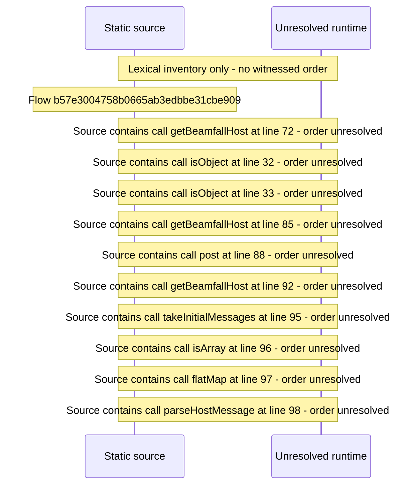

# Native app\-store host bridge: host messages, open in native player — flow-diagram

Source revision: 6742c2361d684c662e9ccb84d344a2200c377582. Trust: generated. Freshness: pinned source; run docs flows check for a later revision.

<!-- flowdocs:paragraph:9a46164cd4ce384f69cb1d719414785a -->
Static source inventory only; sequence and runtime ordering are unresolved\.

Source: internal/web/app/src/lib/beamfallHost\.ts:9; symbol: BeamfallHost; span SHA256: 24f509a1866fc546236c869936714236b211761800ec4d286d8c0ca7aea18835.

