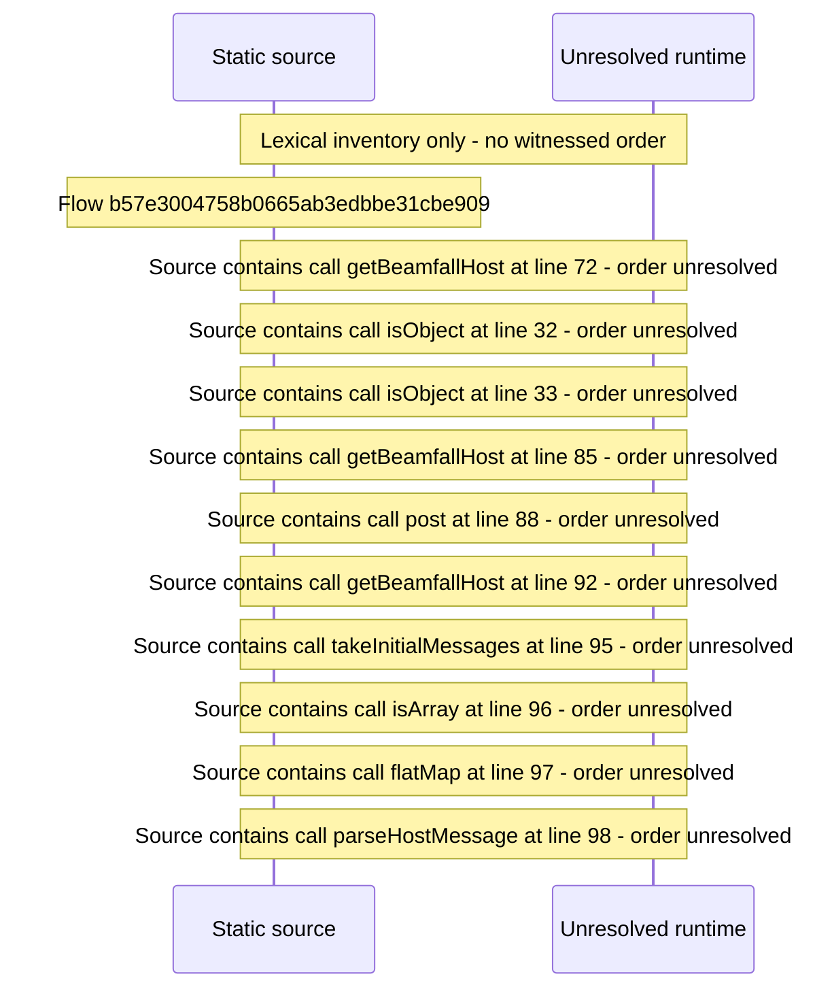

# Native app\-store host bridge: host messages, open in native player — flow-diagram

Source revision: e417fb394873a04fbd27fb8d5bcbca5484c8747f. Trust: generated. Freshness: pinned source; run docs flows check for a later revision.

<!-- flowdocs:paragraph:9a46164cd4ce384f69cb1d719414785a -->
Static source inventory only; sequence and runtime ordering are unresolved\.

Source: internal/web/app/src/lib/beamfallHost\.ts:59; symbol: getBeamfallHost; span SHA256: 28f1c7291b785b4f820dda3e6f6585e500042d93b42b9fc7c780d15edca7253b.

