# Manage markers: segment edit, bulk delete, trashed markers — flow-diagram

Source revision: e2ffd915f3bda309ca8792f07724053b048ba15f. Trust: generated. Freshness: pinned source; run docs flows check for a later revision.

<!-- flowdocs:paragraph:7d953f859a790e0b580890ea7829b735 -->
Static source inventory only; sequence and runtime ordering are unresolved\.

Source: internal/web/app/src/areas/manage/pages/MarkersPage\.tsx:603; symbol: BulkDeleteConfirm; span SHA256: 06875e3212b9669e3dc36e7164f0f7193644d51ad12ab79d317d837f8da0d044.

```mermaid
sequenceDiagram
    participant S as Static source
    participant U as Unresolved runtime
    Note over S,U: Lexical inventory only - no witnessed order
    Note over S: Flow b7d7e23b5dca20ad45fe1f0fbfd7069b
    Note over S,U: Source contains call useT at line 612 - order unresolved
    Note over S,U: Source contains call t at line 622 - order unresolved
    Note over S,U: Source contains call t at line 627 - order unresolved
    Note over S,U: Source contains call t at line 628 - order unresolved
    Note over S,U: Source contains call t at line 631 - order unresolved
    Note over S,U: Source contains call t at line 636 - order unresolved
    Note over S,U: Source contains call useT at line 469 - order unresolved
    Note over S,U: Source contains call useState at line 472 - order unresolved
    Note over S,U: Source contains call useState at line 473 - order unresolved
    Note over S,U: Source contains call useT at line 430 - order unresolved
    Note over S,U: Source contains call t at line 435 - order unresolved
    Note over S,U: Source contains call t at line 440 - order unresolved
    Note over S,U: Source contains call t at line 441 - order unresolved
    Note over S,U: Source contains call t at line 444 - order unresolved
    Note over S,U: Source contains call t at line 449 - order unresolved
    Note over S,U: Source contains call useT at line 232 - order unresolved
    Note over S,U: Source contains call toDraft at line 233 - order unresolved
    Note over S,U: Source contains call useState at line 234 - order unresolved
    Note over S,U: Source contains call useEffect at line 238 - order unresolved
    Note over S,U: Source contains call setDraft at line 239 - order unresolved
    Note over S,U: Source contains call toDraft at line 239 - order unresolved
    Note over S,U: Source contains call useT at line 83 - order unresolved
    Note over S,U: Source contains call useState at line 84 - order unresolved
    Note over S,U: Source contains call useState at line 85 - order unresolved
    Note over S,U: Source contains call Set at line 88 - order unresolved
    Note over S,U: Source contains call useState at line 89 - order unresolved
    Note over S,U: Source contains call useState at line 90 - order unresolved
    Note over S,U: Source contains call useCallback at line 92 - order unresolved
    Note over S,U: Source contains call async at line 93 - order unresolved
    Note over S,U: Source contains call setError at line 94 - order unresolved
    Note over S,U: Source contains call trim at line 95 - order unresolved
    Note over S,U: Source contains call all at line 98 - order unresolved
    Note over S,U: Source contains call fetchMarkers at line 98 - order unresolved
    Note over S,U: Source contains call fetchTrashedMarkers at line 98 - order unresolved
    Note over S,U: Source contains call setMediaID at line 99 - order unresolved
    Note over S,U: Source contains call setMarkers at line 100 - order unresolved
    Note over S,U: Source contains call sort at line 100 - order unresolved
    Note over S,U: Source contains call setTrashed at line 101 - order unresolved
    Note over S,U: Source contains call setSelected at line 102 - order unresolved
    Note over S,U: Source contains call Set at line 102 - order unresolved
    Note over S,U: Source contains call setLoaded at line 103 - order unresolved
    Note over S,U: Source contains call setError at line 105 - order unresolved
    Note over S,U: Source contains call t at line 105 - order unresolved
    Note over S,U: Source contains call useT at line 656 - order unresolved
    Note over S,U: Source contains call localeCompare at line 79 - order unresolved
    Note over S,U: Source contains call async at line 502 - order unresolved
    Note over S,U: Source contains call onError at line 503 - order unresolved
    Note over S,U: Source contains call all at line 506 - order unresolved
    Note over S,U: Source contains call map at line 506 - order unresolved
    Note over S,U: Source contains call deleteMarker at line 506 - order unresolved
    Note over S,U: Source contains call onApplied at line 507 - order unresolved
    Note over S,U: Source contains call onError at line 509 - order unresolved
    Note over S,U: Source contains call t at line 509 - order unresolved
    Note over S,U: Source contains call async at line 114 - order unresolved
    Note over S,U: Source contains call setError at line 116 - order unresolved
    Note over S,U: Source contains call createMarker at line 118 - order unresolved
    Note over S,U: Source contains call blankDraft at line 118 - order unresolved
    Note over S,U: Source contains call load at line 119 - order unresolved
    Note over S,U: Source contains call setError at line 121 - order unresolved
    Note over S,U: Source contains call t at line 121 - order unresolved
    Note over S,U: Source contains call async at line 282 - order unresolved
    Note over S,U: Source contains call onError at line 283 - order unresolved
    Note over S,U: Source contains call deleteMarker at line 285 - order unresolved
    Note over S,U: Source contains call onSaved at line 286 - order unresolved
    Note over S,U: Source contains call onError at line 288 - order unresolved
    Note over S,U: Source contains call t at line 288 - order unresolved
    Note over S,U: Source contains call load at line 111 - order unresolved
    Note over S,U: Source contains call async at line 658 - order unresolved
    Note over S,U: Source contains call onError at line 659 - order unresolved
    Note over S,U: Source contains call restoreMarker at line 661 - order unresolved
    Note over S,U: Source contains call onRestored at line 662 - order unresolved
    Note over S,U: Source contains call onError at line 664 - order unresolved
    Note over S,U: Source contains call t at line 664 - order unresolved
    Note over S,U: Source contains call async at line 484 - order unresolved
    Note over S,U: Source contains call onError at line 485 - order unresolved
    Note over S,U: Source contains call all at line 488 - order unresolved
    Note over S,U: Source contains call map at line 489 - order unresolved
    Note over S,U: Source contains call toDraft at line 490 - order unresolved
    Note over S,U: Source contains call Set at line 491 - order unresolved
    Note over S,U: Source contains call updateMarker at line 492 - order unresolved
    Note over S,U: Source contains call setApplied at line 495 - order unresolved
    Note over S,U: Source contains call onApplied at line 496 - order unresolved
    Note over S,U: Source contains call onError at line 498 - order unresolved
    Note over S,U: Source contains call t at line 498 - order unresolved
    Note over S,U: Source contains call async at line 254 - order unresolved
    Note over S,U: Source contains call onError at line 255 - order unresolved
    Note over S,U: Source contains call updateMarker at line 257 - order unresolved
    Note over S,U: Source contains call onSaved at line 258 - order unresolved
    Note over S,U: Source contains call onError at line 260 - order unresolved
    Note over S,U: Source contains call t at line 260 - order unresolved
    Note over S,U: Source contains call useCallback at line 125 - order unresolved
    Note over S,U: Source contains call load at line 125 - order unresolved
    Note over S,U: Source contains call useCallback at line 112 - order unresolved
    Note over S,U: Source contains call load at line 112 - order unresolved
    Note over S,U: Source contains call set at line 252 - order unresolved
    Note over S,U: Source contains call filter at line 252 - order unresolved
    Note over S,U: Source contains call setDraft at line 242 - order unresolved
    Note over S,U: Source contains call async at line 266 - order unresolved
    Note over S,U: Source contains call onError at line 267 - order unresolved
    Note over S,U: Source contains call all at line 269 - order unresolved
    Note over S,U: Source contains call updateMarker at line 270 - order unresolved
    Note over S,U: Source contains call updateMarker at line 271 - order unresolved
    Note over S,U: Source contains call toDraft at line 272 - order unresolved
    Note over S,U: Source contains call onSaved at line 276 - order unresolved
    Note over S,U: Source contains call onError at line 278 - order unresolved
    Note over S,U: Source contains call t at line 278 - order unresolved
    Note over S,U: Source contains call setSelected at line 128 - order unresolved
    Note over S,U: Source contains call Set at line 129 - order unresolved
    Note over S,U: Source contains call add at line 130 - order unresolved
    Note over S,U: Source contains call delete at line 131 - order unresolved
```

