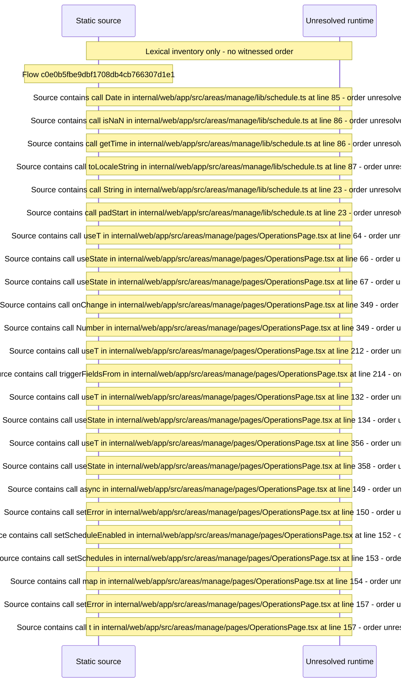

# Manage operations: jobs, schedules, folder watcher — flow-diagram

Source revision: 6742c2361d684c662e9ccb84d344a2200c377582. Trust: generated. Freshness: pinned source; run docs flows check for a later revision.

<!-- flowdocs:paragraph:32a97d2cf6162675c626e9cf9dbd73e5 -->
Static source inventory only; sequence and runtime ordering are unresolved\.

Source: internal/web/app/src/areas/manage/lib/schedule\.ts:48; symbol: TriggerFields; span SHA256: ca19feaf51a5b803a084aabbd6aebdde46ffcd58516ea0c62e1b87465a3acd35.

