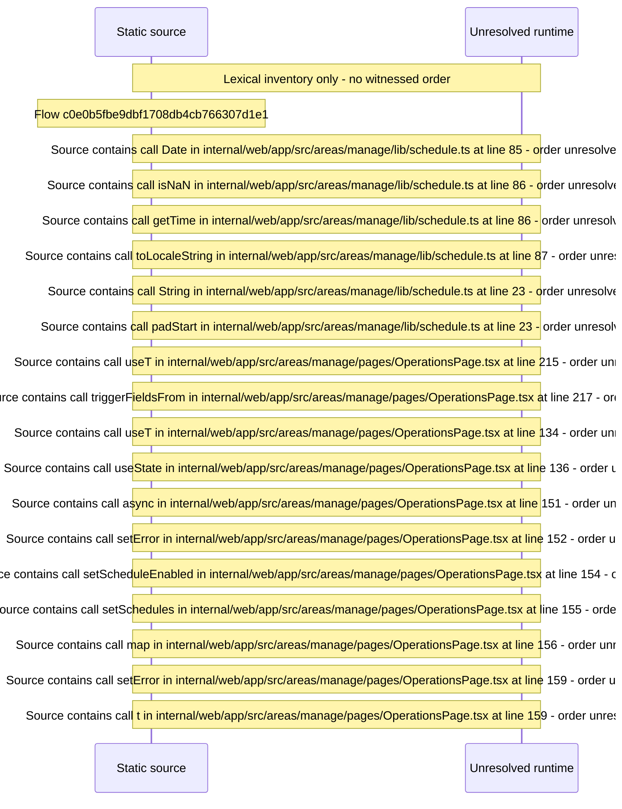

# Manage operations: jobs, schedules, folder watcher — flow-diagram

Source revision: 5ffe7939da2318f5153b1a20d0ef6ef94deef162. Trust: generated. Freshness: pinned source; run docs flows check for a later revision.

<!-- flowdocs:paragraph:32a97d2cf6162675c626e9cf9dbd73e5 -->
Static source inventory only; sequence and runtime ordering are unresolved\.

Source: internal/web/app/src/areas/manage/lib/schedule\.ts:84; symbol: formatDateTime; span SHA256: 4c4f22aad3de466b51cd4fb27a8e47bb30b49fd73e9f5433d3cc6725e95cc64a.

