# Console activity log — flow-diagram

Source revision: 6742c2361d684c662e9ccb84d344a2200c377582. Trust: generated. Freshness: pinned source; run docs flows check for a later revision.

<!-- flowdocs:paragraph:6e81a010e4a044e5daa9f13522f02f91 -->
Static source inventory only; sequence and runtime ordering are unresolved\.

Source: internal/web/app/src/areas/console/sections/ActivityLog\.tsx:211; symbol: ActivityEntryRows; span SHA256: 676a3a4b813614bd0d0b1d72debd68b18a0bbd07da249db98dad8119376437c5.

```mermaid
sequenceDiagram
    participant S as Static source
    participant U as Unresolved runtime
    Note over S,U: Lexical inventory only - no witnessed order
    Note over S: Flow c2d11ac6b11f10c01dc526c1909a1195
    Note over S,U: Source contains call parseActivityTime in internal/web/app/src/areas/console/sections/ActivityLog.tsx at line 226 - order unresolved
    Note over S,U: Source contains call formatUtcTime in internal/web/app/src/areas/console/sections/ActivityLog.tsx at line 227 - order unresolved
    Note over S,U: Source contains call filter in internal/web/app/src/areas/console/sections/ActivityLog.tsx at line 228 - order unresolved
    Note over S,U: Source contains call join in internal/web/app/src/areas/console/sections/ActivityLog.tsx at line 228 - order unresolved
    Note over S,U: Source contains call formatRelativeTime in internal/web/app/src/areas/console/sections/ActivityLog.tsx at line 238 - order unresolved
    Note over S,U: Source contains call formatLocalTime in internal/web/app/src/areas/console/sections/ActivityLog.tsx at line 240 - order unresolved
    Note over S,U: Source contains call filter in internal/web/app/src/areas/console/sections/ActivityLog.tsx at line 276 - order unresolved
    Note over S,U: Source contains call join in internal/web/app/src/areas/console/sections/ActivityLog.tsx at line 276 - order unresolved
    Note over S,U: Source contains call useT in internal/web/app/src/areas/console/sections/ActivityLog.tsx at line 89 - order unresolved
    Note over S,U: Source contains call useDisplayLocale in internal/web/app/src/areas/console/sections/ActivityLog.tsx at line 90 - order unresolved
    Note over S,U: Source contains call useMinuteClock in internal/web/app/src/areas/console/sections/ActivityLog.tsx at line 91 - order unresolved
    Note over S,U: Source contains call useAsync in internal/web/app/src/areas/console/sections/ActivityLog.tsx at line 92 - order unresolved
    Note over S,U: Source contains call useState in internal/web/app/src/areas/console/sections/ActivityLog.tsx at line 93 - order unresolved
    Note over S,U: Source contains call Set in internal/web/app/src/areas/console/sections/ActivityLog.tsx at line 95 - order unresolved
    Note over S,U: Source contains call useMemo in internal/web/app/src/areas/console/sections/ActivityLog.tsx at line 97 - order unresolved
    Note over S,U: Source contains call map in internal/web/app/src/areas/console/sections/ActivityLog.tsx at line 99 - order unresolved
    Note over S,U: Source contains call describeActivity in internal/web/app/src/areas/console/sections/ActivityLog.tsx at line 99 - order unresolved
    Note over S,U: Source contains call all in internal/web/app/src/areas/console/sections/ActivityLog.tsx at line 54 - order unresolved
    Note over S,U: Source contains call fetchActivityRecords in internal/web/app/src/areas/console/sections/ActivityLog.tsx at line 55 - order unresolved
    Note over S,U: Source contains call namesBy in internal/web/app/src/areas/console/sections/ActivityLog.tsx at line 56 - order unresolved
    Note over S,U: Source contains call fetchProfilesAdmin in internal/web/app/src/areas/console/sections/ActivityLog.tsx at line 57 - order unresolved
    Note over S,U: Source contains call namesBy in internal/web/app/src/areas/console/sections/ActivityLog.tsx at line 61 - order unresolved
    Note over S,U: Source contains call fetchDevices in internal/web/app/src/areas/console/sections/ActivityLog.tsx at line 62 - order unresolved
    Note over S,U: Source contains call namesBy in internal/web/app/src/areas/console/sections/ActivityLog.tsx at line 66 - order unresolved
    Note over S,U: Source contains call fetchLibraries in internal/web/app/src/areas/console/sections/ActivityLog.tsx at line 67 - order unresolved
    Note over S,U: Source contains call useState in internal/web/app/src/areas/console/sections/ActivityLog.tsx at line 77 - order unresolved
    Note over S,U: Source contains call Date in internal/web/app/src/areas/console/sections/ActivityLog.tsx at line 77 - order unresolved
    Note over S,U: Source contains call useEffect in internal/web/app/src/areas/console/sections/ActivityLog.tsx at line 78 - order unresolved
    Note over S,U: Source contains call setInterval in internal/web/app/src/areas/console/sections/ActivityLog.tsx at line 79 - order unresolved
    Note over S,U: Source contains call setNow in internal/web/app/src/areas/console/sections/ActivityLog.tsx at line 79 - order unresolved
    Note over S,U: Source contains call Date in internal/web/app/src/areas/console/sections/ActivityLog.tsx at line 79 - order unresolved
    Note over S,U: Source contains call clearInterval in internal/web/app/src/areas/console/sections/ActivityLog.tsx at line 80 - order unresolved
    Note over S,U: Source contains call map in internal/web/app/src/lib/graphql/console.ts at line 750 - order unresolved
    Note over S,U: Source contains call useMemo in internal/web/app/src/areas/console/sections/ActivityLog.tsx at line 102 - order unresolved
    Note over S,U: Source contains call set in internal/web/app/src/areas/console/sections/ActivityLog.tsx at line 105 - order unresolved
    Note over S,U: Source contains call get in internal/web/app/src/areas/console/sections/ActivityLog.tsx at line 105 - order unresolved
```

