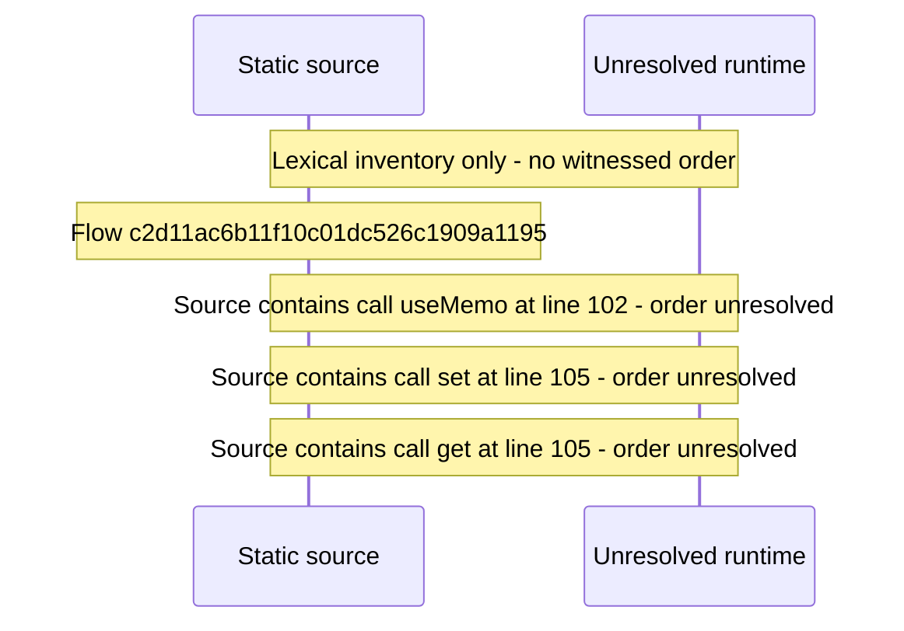

# Console activity log — flow-diagram

Source revision: d442b4a6a38de86be0670669b3a3f6aa47e80b22. Trust: generated. Freshness: pinned source; run docs flows check for a later revision.

<!-- flowdocs:paragraph:6e81a010e4a044e5daa9f13522f02f91 -->
Static source inventory only; sequence and runtime ordering are unresolved\.

Source: internal/web/app/src/lib/graphql/activity\.ts:29; symbol: fetchActivityRecords; span SHA256: e2460710fdc21e4597b1fd8e53ba346ae2334d2da793921aa1f38be266fa65d5.

