# Shared workbench widgets: status chips, tables, forms, server path picker — flow-diagram

Source revision: e417fb394873a04fbd27fb8d5bcbca5484c8747f. Trust: generated. Freshness: pinned source; run docs flows check for a later revision.

<!-- flowdocs:paragraph:bfaba6c9df1357a9d39b2c9607bf8f7f -->
Static source inventory only; sequence and runtime ordering are unresolved\.

Source: internal/web/app/src/components/beamfall/workbench/PathPickerField\.tsx:582; symbol: BrowserMessage; span SHA256: 565a53e0e7456e363d84abc4a68e7b2d435fafca173a70f6698306ae42c6d4a5.

```mermaid
sequenceDiagram
    participant S as Static source
    participant U as Unresolved runtime
    Note over S,U: Lexical inventory only - no witnessed order
    Note over S: Flow c2dbd86a641b4d403b46dde9ead7bab6
    Note over S,U: Source contains call useT in internal/web/app/src/components/beamfall/workbench/PathPickerField.tsx at line 170 - order unresolved
    Note over S,U: Source contains call useId in internal/web/app/src/components/beamfall/workbench/PathPickerField.tsx at line 171 - order unresolved
    Note over S,U: Source contains call hostDistributionClass in internal/web/app/src/components/beamfall/workbench/PathPickerField.tsx at line 172 - order unresolved
    Note over S,U: Source contains call useState in internal/web/app/src/components/beamfall/workbench/PathPickerField.tsx at line 175 - order unresolved
    Note over S,U: Source contains call useState in internal/web/app/src/components/beamfall/workbench/PathPickerField.tsx at line 177 - order unresolved
    Note over S,U: Source contains call useState in internal/web/app/src/components/beamfall/workbench/PathPickerField.tsx at line 178 - order unresolved
    Note over S,U: Source contains call useRef in internal/web/app/src/components/beamfall/workbench/PathPickerField.tsx at line 180 - order unresolved
    Note over S,U: Source contains call useRef in internal/web/app/src/components/beamfall/workbench/PathPickerField.tsx at line 181 - order unresolved
    Note over S,U: Source contains call useEffect in internal/web/app/src/components/beamfall/workbench/PathPickerField.tsx at line 190 - order unresolved
    Note over S,U: Source contains call focus in internal/web/app/src/components/beamfall/workbench/PathPickerField.tsx at line 195 - order unresolved
    Note over S,U: Source contains call getBeamfallHost in internal/web/app/src/components/beamfall/workbench/PathPickerField.tsx at line 110 - order unresolved
    Note over S,U: Source contains call separatorOf in internal/web/app/src/components/beamfall/workbench/PathPickerField.tsx at line 52 - order unresolved
    Note over S,U: Source contains call startsWith in internal/web/app/src/components/beamfall/workbench/PathPickerField.tsx at line 53 - order unresolved
    Note over S,U: Source contains call endsWith in internal/web/app/src/components/beamfall/workbench/PathPickerField.tsx at line 53 - order unresolved
    Note over S,U: Source contains call pathPickerRootFor in internal/web/app/src/components/beamfall/workbench/PathPickerField.tsx at line 84 - order unresolved
    Note over S,U: Source contains call separatorOf in internal/web/app/src/components/beamfall/workbench/PathPickerField.tsx at line 86 - order unresolved
    Note over S,U: Source contains call endsWith in internal/web/app/src/components/beamfall/workbench/PathPickerField.tsx at line 88 - order unresolved
    Note over S,U: Source contains call slice in internal/web/app/src/components/beamfall/workbench/PathPickerField.tsx at line 88 - order unresolved
    Note over S,U: Source contains call slice in internal/web/app/src/components/beamfall/workbench/PathPickerField.tsx at line 89 - order unresolved
    Note over S,U: Source contains call split in internal/web/app/src/components/beamfall/workbench/PathPickerField.tsx at line 89 - order unresolved
    Note over S,U: Source contains call filter in internal/web/app/src/components/beamfall/workbench/PathPickerField.tsx at line 89 - order unresolved
    Note over S,U: Source contains call push in internal/web/app/src/components/beamfall/workbench/PathPickerField.tsx at line 91 - order unresolved
    Note over S,U: Source contains call pathPickerRootFor in internal/web/app/src/components/beamfall/workbench/PathPickerField.tsx at line 70 - order unresolved
    Note over S,U: Source contains call slice in internal/web/app/src/components/beamfall/workbench/PathPickerField.tsx at line 72 - order unresolved
    Note over S,U: Source contains call lastIndexOf in internal/web/app/src/components/beamfall/workbench/PathPickerField.tsx at line 72 - order unresolved
    Note over S,U: Source contains call separatorOf in internal/web/app/src/components/beamfall/workbench/PathPickerField.tsx at line 72 - order unresolved
    Note over S,U: Source contains call includes in internal/web/app/src/components/beamfall/workbench/PathPickerField.tsx at line 47 - order unresolved
    Note over S,U: Source contains call useT in internal/web/app/src/components/beamfall/workbench/index.tsx at line 226 - order unresolved
    Note over S,U: Source contains call t in internal/web/app/src/components/beamfall/workbench/index.tsx at line 230 - order unresolved
    Note over S,U: Source contains call t in internal/web/app/src/components/beamfall/workbench/index.tsx at line 231 - order unresolved
    Note over S,U: Source contains call map in internal/web/app/src/components/beamfall/workbench/index.tsx at line 81 - order unresolved
    Note over S,U: Source contains call useT in internal/web/app/src/components/beamfall/workbench/index.tsx at line 121 - order unresolved
    Note over S,U: Source contains call t in internal/web/app/src/components/beamfall/workbench/index.tsx at line 126 - order unresolved
    Note over S,U: Source contains call useT in internal/web/app/src/components/beamfall/workbench/index.tsx at line 133 - order unresolved
    Note over S,U: Source contains call t in internal/web/app/src/components/beamfall/workbench/index.tsx at line 137 - order unresolved
    Note over S,U: Source contains call useT in internal/web/app/src/components/beamfall/workbench/index.tsx at line 197 - order unresolved
    Note over S,U: Source contains call t in internal/web/app/src/components/beamfall/workbench/index.tsx at line 201 - order unresolved
    Note over S,U: Source contains call t in internal/web/app/src/components/beamfall/workbench/index.tsx at line 209 - order unresolved
    Note over S,U: Source contains call t in internal/web/app/src/components/beamfall/workbench/index.tsx at line 210 - order unresolved
    Note over S,U: Source contains call cn in internal/web/app/src/components/beamfall/workbench/index.tsx at line 178 - order unresolved
    Note over S,U: Source contains call cn in internal/web/app/src/components/beamfall/workbench/index.tsx at line 163 - order unresolved
    Note over S,U: Source contains call cn in internal/web/app/src/components/beamfall/workbench/index.tsx at line 111 - order unresolved
    Note over S,U: Source contains call cn in internal/web/app/src/components/beamfall/workbench/index.tsx at line 63 - order unresolved
    Note over S,U: Source contains call cn in internal/web/app/src/components/beamfall/workbench/index.tsx at line 43 - order unresolved
    Note over S,U: Source contains call from in internal/web/app/src/components/beamfall/workbench/index.tsx at line 97 - order unresolved
    Note over S,U: Source contains call map in internal/web/app/src/components/beamfall/workbench/index.tsx at line 97 - order unresolved
    Note over S,U: Source contains call from in internal/web/app/src/components/beamfall/workbench/index.tsx at line 99 - order unresolved
    Note over S,U: Source contains call map in internal/web/app/src/components/beamfall/workbench/index.tsx at line 99 - order unresolved
    Note over S,U: Source contains call setBusy in internal/web/app/src/components/beamfall/workbench/PathPickerField.tsx at line 239 - order unresolved
    Note over S,U: Source contains call setFailed in internal/web/app/src/components/beamfall/workbench/PathPickerField.tsx at line 240 - order unresolved
    Note over S,U: Source contains call addPathPickerRoot in internal/web/app/src/components/beamfall/workbench/PathPickerField.tsx at line 242 - order unresolved
    Note over S,U: Source contains call load in internal/web/app/src/components/beamfall/workbench/PathPickerField.tsx at line 244 - order unresolved
    Note over S,U: Source contains call setBusy in internal/web/app/src/components/beamfall/workbench/PathPickerField.tsx at line 247 - order unresolved
    Note over S,U: Source contains call setFailed in internal/web/app/src/components/beamfall/workbench/PathPickerField.tsx at line 248 - order unresolved
    Note over S,U: Source contains call t in internal/web/app/src/components/beamfall/workbench/PathPickerField.tsx at line 250 - order unresolved
    Note over S,U: Source contains call setOpen in internal/web/app/src/components/beamfall/workbench/PathPickerField.tsx at line 232 - order unresolved
    Note over S,U: Source contains call setBusy in internal/web/app/src/components/beamfall/workbench/PathPickerField.tsx at line 233 - order unresolved
    Note over S,U: Source contains call focus in internal/web/app/src/components/beamfall/workbench/PathPickerField.tsx at line 234 - order unresolved
    Note over S,U: Source contains call onChange in internal/web/app/src/components/beamfall/workbench/PathPickerField.tsx at line 259 - order unresolved
    Note over S,U: Source contains call onSelect in internal/web/app/src/components/beamfall/workbench/PathPickerField.tsx at line 260 - order unresolved
    Note over S,U: Source contains call close in internal/web/app/src/components/beamfall/workbench/PathPickerField.tsx at line 261 - order unresolved
    Note over S,U: Source contains call setBusy in internal/web/app/src/components/beamfall/workbench/PathPickerField.tsx at line 202 - order unresolved
    Note over S,U: Source contains call setFailed in internal/web/app/src/components/beamfall/workbench/PathPickerField.tsx at line 203 - order unresolved
    Note over S,U: Source contains call fetchPathPicker in internal/web/app/src/components/beamfall/workbench/PathPickerField.tsx at line 205 - order unresolved
    Note over S,U: Source contains call setView in internal/web/app/src/components/beamfall/workbench/PathPickerField.tsx at line 217 - order unresolved
    Note over S,U: Source contains call setCurrent in internal/web/app/src/components/beamfall/workbench/PathPickerField.tsx at line 218 - order unresolved
    Note over S,U: Source contains call setFailed in internal/web/app/src/components/beamfall/workbench/PathPickerField.tsx at line 221 - order unresolved
    Note over S,U: Source contains call t in internal/web/app/src/components/beamfall/workbench/PathPickerField.tsx at line 223 - order unresolved
    Note over S,U: Source contains call setBusy in internal/web/app/src/components/beamfall/workbench/PathPickerField.tsx at line 226 - order unresolved
```

