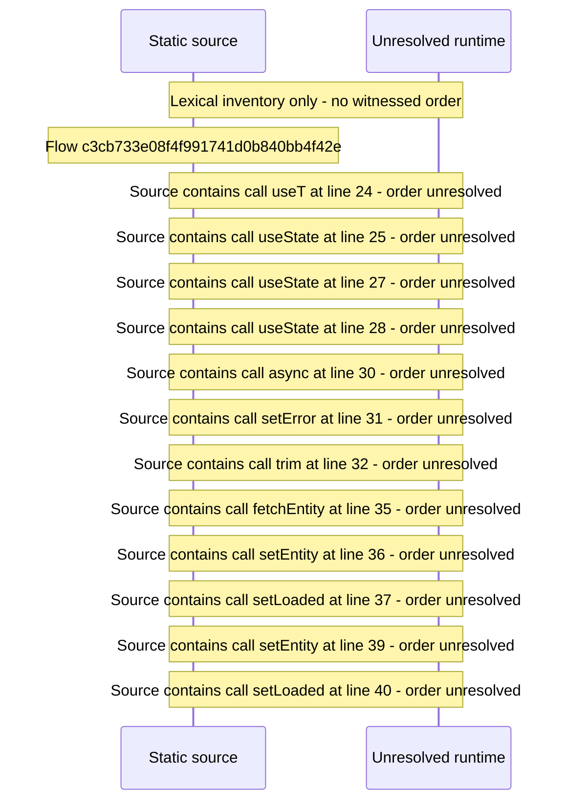

# Manage entities — flow-diagram

Source revision: 6742c2361d684c662e9ccb84d344a2200c377582. Trust: generated. Freshness: pinned source; run docs flows check for a later revision.

<!-- flowdocs:paragraph:521fb7e985d78cfda5d23ee318b3f641 -->
Static source inventory only; sequence and runtime ordering are unresolved\.

Source: internal/web/app/src/areas/manage/pages/EntityPage\.tsx:23; symbol: EntityPage; span SHA256: 397517278d0181aa246f1fee6658b0eb41f983aa5dc7b254ae00d382ea6d7ad6.

