# Console live sessions and host graphs — flow-diagram

Source revision: b952880cf4519beaa9738e25e349aabf600c9a41. Trust: generated. Freshness: pinned source; run docs flows check for a later revision.

<!-- flowdocs:paragraph:198e3a25e0ede1625afdc13a7bb02504 -->
Static source inventory only; sequence and runtime ordering are unresolved\.

Source: internal/web/app/src/areas/console/sections/Dashboard\.tsx:339; symbol: CHART\_HEIGHT; span SHA256: 795a0efbd16af2c292727707936c42deca150072ae3d45c960aba52fb4eb6337.

```mermaid
sequenceDiagram
    participant S as Static source
    participant U as Unresolved runtime
    Note over S,U: Lexical inventory only - no witnessed order
    Note over S: Flow c561bb20ac01b5f30568584d65ffbaca
    Note over S,U: Source contains call useT at line 590 - order unresolved
    Note over S,U: Source contains call useAsync at line 591 - order unresolved
    Note over S,U: Source contains call usePolling at line 592 - order unresolved
    Note over S,U: Source contains call map at line 594 - order unresolved
    Note over S,U: Source contains call parse at line 594 - order unresolved
    Note over S,U: Source contains call map at line 607 - order unresolved
    Note over S,U: Source contains call some at line 608 - order unresolved
    Note over S,U: Source contains call map at line 609 - order unresolved
    Note over S,U: Source contains call map at line 610 - order unresolved
    Note over S,U: Source contains call map at line 612 - order unresolved
    Note over S,U: Source contains call some at line 613 - order unresolved
    Note over S,U: Source contains call max at line 614 - order unresolved
    Note over S,U: Source contains call map at line 614 - order unresolved
    Note over S,U: Source contains call t at line 619 - order unresolved
    Note over S,U: Source contains call t at line 622 - order unresolved
    Note over S,U: Source contains call t at line 629 - order unresolved
    Note over S,U: Source contains call t at line 631 - order unresolved
    Note over S,U: Source contains call t at line 636 - order unresolved
    Note over S,U: Source contains call t at line 639 - order unresolved
    Note over S,U: Source contains call formatBytes at line 640 - order unresolved
    Note over S,U: Source contains call formatBytes at line 641 - order unresolved
    Note over S,U: Source contains call t at line 646 - order unresolved
    Note over S,U: Source contains call t at line 653 - order unresolved
    Note over S,U: Source contains call t at line 655 - order unresolved
    Note over S,U: Source contains call t at line 659 - order unresolved
    Note over S,U: Source contains call t at line 663 - order unresolved
    Note over S,U: Source contains call t at line 665 - order unresolved
    Note over S,U: Source contains call niceMax at line 671 - order unresolved
    Note over S,U: Source contains call useT at line 365 - order unresolved
    Note over S,U: Source contains call useId at line 366 - order unresolved
    Note over S,U: Source contains call useWidth at line 367 - order unresolved
    Note over S,U: Source contains call now at line 370 - order unresolved
    Note over S,U: Source contains call max at line 372 - order unresolved
    Note over S,U: Source contains call useAsync at line 304 - order unresolved
    Note over S,U: Source contains call useEventRefresh at line 305 - order unresolved
    Note over S,U: Source contains call usePolling at line 306 - order unresolved
    Note over S,U: Source contains call useT at line 179 - order unresolved
    Note over S,U: Source contains call useAsync at line 180 - order unresolved
    Note over S,U: Source contains call useAsync at line 184 - order unresolved
    Note over S,U: Source contains call find at line 185 - order unresolved
    Note over S,U: Source contains call useEventRefresh at line 187 - order unresolved
    Note over S,U: Source contains call usePolling at line 188 - order unresolved
    Note over S,U: Source contains call useT at line 146 - order unresolved
    Note over S,U: Source contains call min at line 148 - order unresolved
    Note over S,U: Source contains call max at line 148 - order unresolved
    Note over S,U: Source contains call t at line 154 - order unresolved
    Note over S,U: Source contains call round at line 157 - order unresolved
    Note over S,U: Source contains call clock at line 162 - order unresolved
    Note over S,U: Source contains call max at line 94 - order unresolved
    Note over S,U: Source contains call floor at line 94 - order unresolved
    Note over S,U: Source contains call floor at line 95 - order unresolved
    Note over S,U: Source contains call floor at line 96 - order unresolved
    Note over S,U: Source contains call String at line 97 - order unresolved
    Note over S,U: Source contains call padStart at line 97 - order unresolved
    Note over S,U: Source contains call max at line 579 - order unresolved
    Note over S,U: Source contains call map at line 579 - order unresolved
    Note over S,U: Source contains call floor at line 580 - order unresolved
    Note over S,U: Source contains call log10 at line 580 - order unresolved
    Note over S,U: Source contains call push at line 570 - order unresolved
    Note over S,U: Source contains call reverse at line 574 - order unresolved
    Note over S,U: Source contains call Date at line 359 - order unresolved
    Note over S,U: Source contains call toLocaleTimeString at line 359 - order unresolved
    Note over S,U: Source contains call useEffect at line 60 - order unresolved
    Note over S,U: Source contains call useEffect at line 46 - order unresolved
    Note over S,U: Source contains call setInterval at line 47 - order unresolved
    Note over S,U: Source contains call refresh at line 48 - order unresolved
    Note over S,U: Source contains call clearInterval at line 50 - order unresolved
    Note over S,U: Source contains call useState at line 344 - order unresolved
    Note over S,U: Source contains call useLayoutEffect at line 345 - order unresolved
    Note over S,U: Source contains call ResizeObserver at line 348 - order unresolved
    Note over S,U: Source contains call round at line 349 - order unresolved
    Note over S,U: Source contains call setWidth at line 350 - order unresolved
    Note over S,U: Source contains call observe at line 352 - order unresolved
    Note over S,U: Source contains call disconnect at line 353 - order unresolved
    Note over S,U: Source contains call getBoundingClientRect at line 393 - order unresolved
    Note over S,U: Source contains call abs at line 397 - order unresolved
    Note over S,U: Source contains call setHover at line 399 - order unresolved
    Note over S,U: Source contains call forEach at line 380 - order unresolved
    Note over S,U: Source contains call async at line 65 - order unresolved
    Note over S,U: Source contains call refresh at line 73 - order unresolved
    Note over S,U: Source contains call setTimeout at line 78 - order unresolved
    Note over S,U: Source contains call terminateSession at line 191 - order unresolved
    Note over S,U: Source contains call signedOut at line 193 - order unresolved
    Note over S,U: Source contains call fetchLiveSessions at line 199 - order unresolved
    Note over S,U: Source contains call isAuthRejection at line 201 - order unresolved
    Note over S,U: Source contains call signedOut at line 202 - order unresolved
    Note over S,U: Source contains call refresh at line 206 - order unresolved
    Note over S,U: Source contains call min at line 375 - order unresolved
```

