# Console live sessions: update awareness, jobs, live sessions and host graphs — flow-diagram

Source revision: d442b4a6a38de86be0670669b3a3f6aa47e80b22. Trust: generated. Freshness: pinned source; run docs flows check for a later revision.

<!-- flowdocs:paragraph:198e3a25e0ede1625afdc13a7bb02504 -->
Static source inventory only; sequence and runtime ordering are unresolved\.

Source: internal/web/app/src/areas/console/sections/Dashboard\.tsx:44; symbol: usePolling; span SHA256: 79204b6661ff75c9aa8ce9572f8308f7b414b417fa173a7d4bfbd3ef33b9b6fe.

```mermaid
sequenceDiagram
    participant S as Static source
    participant U as Unresolved runtime
    Note over S,U: Lexical inventory only - no witnessed order
    Note over S: Flow c561bb20ac01b5f30568584d65ffbaca
    Note over S,U: Source contains call useEffect in internal/web/app/src/areas/console/sections/Dashboard.tsx at line 45 - order unresolved
    Note over S,U: Source contains call setInterval in internal/web/app/src/areas/console/sections/Dashboard.tsx at line 46 - order unresolved
    Note over S,U: Source contains call refresh in internal/web/app/src/areas/console/sections/Dashboard.tsx at line 47 - order unresolved
    Note over S,U: Source contains call clearInterval in internal/web/app/src/areas/console/sections/Dashboard.tsx at line 49 - order unresolved
    Note over S,U: Source contains call useT in internal/web/app/src/areas/console/sections/Operations.tsx at line 351 - order unresolved
    Note over S,U: Source contains call useAsync in internal/web/app/src/areas/console/sections/Operations.tsx at line 352 - order unresolved
    Note over S,U: Source contains call useRef in internal/web/app/src/areas/console/sections/Operations.tsx at line 355 - order unresolved
    Note over S,U: Source contains call useEffect in internal/web/app/src/areas/console/sections/Operations.tsx at line 357 - order unresolved
    Note over S,U: Source contains call subscribeEvents in internal/web/app/src/areas/console/sections/Operations.tsx at line 358 - order unresolved
    Note over S,U: Source contains call refresh in internal/web/app/src/areas/console/sections/Operations.tsx at line 359 - order unresolved
    Note over S,U: Source contains call setStream in internal/web/app/src/areas/console/sections/Operations.tsx at line 364 - order unresolved
    Note over S,U: Source contains call setStream in internal/web/app/src/areas/console/sections/Operations.tsx at line 367 - order unresolved
    Note over S,U: Source contains call map in internal/web/app/src/areas/console/sections/Operations.tsx at line 387 - order unresolved
    Note over S,U: Source contains call round in internal/web/app/src/areas/console/sections/Operations.tsx at line 389 - order unresolved
    Note over S,U: Source contains call statusTone in internal/web/app/src/areas/console/sections/Operations.tsx at line 390 - order unresolved
    Note over S,U: Source contains call jobKindLabel in internal/web/app/src/areas/console/sections/Operations.tsx at line 393 - order unresolved
    Note over S,U: Source contains call t in internal/web/app/src/areas/console/sections/Operations.tsx at line 400 - order unresolved
    Note over S,U: Source contains call jobProgressDetail in internal/web/app/src/areas/console/sections/Operations.tsx at line 407 - order unresolved
    Note over S,U: Source contains call jobStatusLabel in internal/web/app/src/areas/console/sections/Operations.tsx at line 408 - order unresolved
    Note over S,U: Source contains call useT in internal/web/app/src/areas/console/sections/Operations.tsx at line 321 - order unresolved
    Note over S,U: Source contains call t in internal/web/app/src/areas/console/sections/Operations.tsx at line 331 - order unresolved
    Note over S,U: Source contains call t in internal/web/app/src/areas/console/sections/Operations.tsx at line 340 - order unresolved
    Note over S,U: Source contains call jobStatusState in internal/web/app/src/areas/console/sections/Operations.tsx at line 30 - order unresolved
    Note over S,U: Source contains call getBoundingClientRect in internal/web/app/src/areas/console/sections/Dashboard.tsx at line 343 - order unresolved
    Note over S,U: Source contains call abs in internal/web/app/src/areas/console/sections/Dashboard.tsx at line 347 - order unresolved
    Note over S,U: Source contains call setHover in internal/web/app/src/areas/console/sections/Dashboard.tsx at line 349 - order unresolved
    Note over S,U: Source contains call forEach in internal/web/app/src/areas/console/sections/Dashboard.tsx at line 330 - order unresolved
    Note over S,U: Source contains call async in internal/web/app/src/areas/console/sections/Dashboard.tsx at line 64 - order unresolved
    Note over S,U: Source contains call refresh in internal/web/app/src/areas/console/sections/Dashboard.tsx at line 72 - order unresolved
    Note over S,U: Source contains call setTimeout in internal/web/app/src/areas/console/sections/Dashboard.tsx at line 77 - order unresolved
    Note over S,U: Source contains call terminateSession in internal/web/app/src/areas/console/sections/Dashboard.tsx at line 178 - order unresolved
    Note over S,U: Source contains call refresh in internal/web/app/src/areas/console/sections/Dashboard.tsx at line 179 - order unresolved
    Note over S,U: Source contains call min in internal/web/app/src/areas/console/sections/Dashboard.tsx at line 325 - order unresolved
    Note over S,U: Source contains call preventDefault in internal/web/app/src/areas/console/sections/Operations.tsx at line 184 - order unresolved
    Note over S,U: Source contains call setConsoleConfig in internal/web/app/src/areas/console/sections/Operations.tsx at line 185 - order unresolved
    Note over S,U: Source contains call setData in internal/web/app/src/areas/console/sections/Operations.tsx at line 189 - order unresolved
    Note over S,U: Source contains call refresh in internal/web/app/src/areas/console/sections/Operations.tsx at line 190 - order unresolved
```

