# Console live sessions and host graphs — flow-diagram

Source revision: 6742c2361d684c662e9ccb84d344a2200c377582. Trust: generated. Freshness: pinned source; run docs flows check for a later revision.

<!-- flowdocs:paragraph:198e3a25e0ede1625afdc13a7bb02504 -->
Static source inventory only; sequence and runtime ordering are unresolved\.

Source: internal/web/app/src/areas/console/sections/Dashboard\.tsx:291; symbol: CHART\_HEIGHT; span SHA256: 795a0efbd16af2c292727707936c42deca150072ae3d45c960aba52fb4eb6337.

```mermaid
sequenceDiagram
    participant S as Static source
    participant U as Unresolved runtime
    Note over S,U: Lexical inventory only - no witnessed order
    Note over S: Flow c561bb20ac01b5f30568584d65ffbaca
    Note over S,U: Source contains call useT at line 542 - order unresolved
    Note over S,U: Source contains call useAsync at line 543 - order unresolved
    Note over S,U: Source contains call usePolling at line 544 - order unresolved
    Note over S,U: Source contains call map at line 546 - order unresolved
    Note over S,U: Source contains call parse at line 546 - order unresolved
    Note over S,U: Source contains call map at line 559 - order unresolved
    Note over S,U: Source contains call some at line 560 - order unresolved
    Note over S,U: Source contains call map at line 561 - order unresolved
    Note over S,U: Source contains call map at line 562 - order unresolved
    Note over S,U: Source contains call map at line 564 - order unresolved
    Note over S,U: Source contains call some at line 565 - order unresolved
    Note over S,U: Source contains call max at line 566 - order unresolved
    Note over S,U: Source contains call map at line 566 - order unresolved
    Note over S,U: Source contains call t at line 571 - order unresolved
    Note over S,U: Source contains call t at line 574 - order unresolved
    Note over S,U: Source contains call t at line 581 - order unresolved
    Note over S,U: Source contains call t at line 583 - order unresolved
    Note over S,U: Source contains call t at line 588 - order unresolved
    Note over S,U: Source contains call t at line 591 - order unresolved
    Note over S,U: Source contains call formatBytes at line 592 - order unresolved
    Note over S,U: Source contains call formatBytes at line 593 - order unresolved
    Note over S,U: Source contains call t at line 598 - order unresolved
    Note over S,U: Source contains call t at line 605 - order unresolved
    Note over S,U: Source contains call t at line 607 - order unresolved
    Note over S,U: Source contains call t at line 611 - order unresolved
    Note over S,U: Source contains call t at line 615 - order unresolved
    Note over S,U: Source contains call t at line 617 - order unresolved
    Note over S,U: Source contains call niceMax at line 623 - order unresolved
    Note over S,U: Source contains call useT at line 317 - order unresolved
    Note over S,U: Source contains call useId at line 318 - order unresolved
    Note over S,U: Source contains call useWidth at line 319 - order unresolved
    Note over S,U: Source contains call now at line 322 - order unresolved
    Note over S,U: Source contains call max at line 324 - order unresolved
    Note over S,U: Source contains call useAsync at line 256 - order unresolved
    Note over S,U: Source contains call useEventRefresh at line 257 - order unresolved
    Note over S,U: Source contains call usePolling at line 258 - order unresolved
    Note over S,U: Source contains call useT at line 170 - order unresolved
    Note over S,U: Source contains call useAsync at line 171 - order unresolved
    Note over S,U: Source contains call useEventRefresh at line 174 - order unresolved
    Note over S,U: Source contains call usePolling at line 175 - order unresolved
    Note over S,U: Source contains call useT at line 142 - order unresolved
    Note over S,U: Source contains call min at line 144 - order unresolved
    Note over S,U: Source contains call max at line 144 - order unresolved
    Note over S,U: Source contains call t at line 150 - order unresolved
    Note over S,U: Source contains call round at line 153 - order unresolved
    Note over S,U: Source contains call clock at line 158 - order unresolved
    Note over S,U: Source contains call max at line 93 - order unresolved
    Note over S,U: Source contains call floor at line 93 - order unresolved
    Note over S,U: Source contains call floor at line 94 - order unresolved
    Note over S,U: Source contains call floor at line 95 - order unresolved
    Note over S,U: Source contains call String at line 96 - order unresolved
    Note over S,U: Source contains call padStart at line 96 - order unresolved
    Note over S,U: Source contains call max at line 531 - order unresolved
    Note over S,U: Source contains call map at line 531 - order unresolved
    Note over S,U: Source contains call floor at line 532 - order unresolved
    Note over S,U: Source contains call log10 at line 532 - order unresolved
    Note over S,U: Source contains call push at line 522 - order unresolved
    Note over S,U: Source contains call reverse at line 526 - order unresolved
    Note over S,U: Source contains call Date at line 311 - order unresolved
    Note over S,U: Source contains call toLocaleTimeString at line 311 - order unresolved
    Note over S,U: Source contains call useEffect at line 59 - order unresolved
    Note over S,U: Source contains call useEffect at line 45 - order unresolved
    Note over S,U: Source contains call setInterval at line 46 - order unresolved
    Note over S,U: Source contains call refresh at line 47 - order unresolved
    Note over S,U: Source contains call clearInterval at line 49 - order unresolved
    Note over S,U: Source contains call useState at line 296 - order unresolved
    Note over S,U: Source contains call useLayoutEffect at line 297 - order unresolved
    Note over S,U: Source contains call ResizeObserver at line 300 - order unresolved
    Note over S,U: Source contains call round at line 301 - order unresolved
    Note over S,U: Source contains call setWidth at line 302 - order unresolved
    Note over S,U: Source contains call observe at line 304 - order unresolved
    Note over S,U: Source contains call disconnect at line 305 - order unresolved
    Note over S,U: Source contains call getBoundingClientRect at line 345 - order unresolved
    Note over S,U: Source contains call abs at line 349 - order unresolved
    Note over S,U: Source contains call setHover at line 351 - order unresolved
    Note over S,U: Source contains call forEach at line 332 - order unresolved
    Note over S,U: Source contains call async at line 64 - order unresolved
    Note over S,U: Source contains call refresh at line 72 - order unresolved
    Note over S,U: Source contains call setTimeout at line 77 - order unresolved
    Note over S,U: Source contains call terminateSession at line 178 - order unresolved
    Note over S,U: Source contains call refresh at line 179 - order unresolved
    Note over S,U: Source contains call min at line 327 - order unresolved
```

