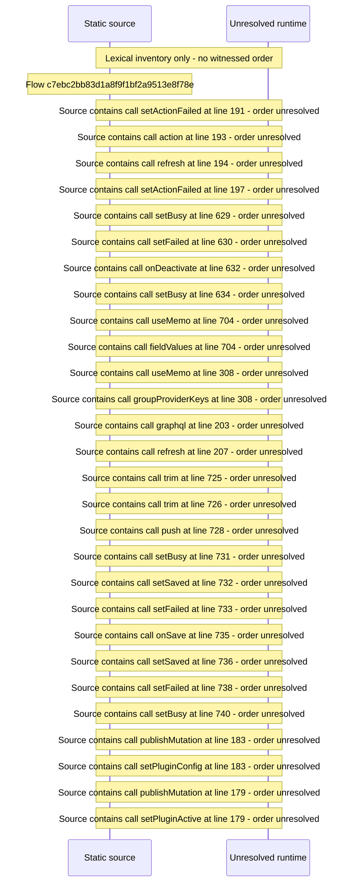

# Console plugins: standing, lifecycle, config editor, provider keys — flow-diagram

Source revision: 5ffe7939da2318f5153b1a20d0ef6ef94deef162. Trust: generated. Freshness: pinned source; run docs flows check for a later revision.

<!-- flowdocs:paragraph:5629adbba4881389c5b286a922a7c260 -->
Static source inventory only; sequence and runtime ordering are unresolved\.

Source: internal/web/app/src/areas/console/sections/Plugins\.tsx:190; symbol: credentialAction; span SHA256: 2ec0e1f09df30b70cd31ff7160b9849f00cfb715504c7571ae12fe761a0d7091.

