# Console plugins: standing, lifecycle, config editor, provider keys — flow-diagram

Source revision: 6742c2361d684c662e9ccb84d344a2200c377582. Trust: generated. Freshness: pinned source; run docs flows check for a later revision.

<!-- flowdocs:paragraph:5629adbba4881389c5b286a922a7c260 -->
Static source inventory only; sequence and runtime ordering are unresolved\.

Source: internal/web/app/src/areas/console/sections/Plugins\.tsx:904; symbol: ActionRow; span SHA256: 2a20e7df7d8ac823ea677063b20d2017cc11d6c03e2b7774889185c0c031b315.

```mermaid
sequenceDiagram
    participant S as Static source
    participant U as Unresolved runtime
    Note over S,U: Lexical inventory only - no witnessed order
    Note over S: Flow c7ebc2bb83d1a8f9f1bf2a9513e8f78e
    Note over S,U: Source contains call useT at line 917 - order unresolved
    Note over S,U: Source contains call useState at line 918 - order unresolved
    Note over S,U: Source contains call useState at line 919 - order unresolved
    Note over S,U: Source contains call displayString at line 920 - order unresolved
    Note over S,U: Source contains call Set at line 47 - order unresolved
    Note over S,U: Source contains call useT at line 778 - order unresolved
    Note over S,U: Source contains call displayString at line 779 - order unresolved
    Note over S,U: Source contains call t at line 780 - order unresolved
    Note over S,U: Source contains call onChange at line 788 - order unresolved
    Note over S,U: Source contains call onChange at line 794 - order unresolved
    Note over S,U: Source contains call t at line 796 - order unresolved
    Note over S,U: Source contains call map at line 799 - order unresolved
    Note over S,U: Source contains call displayString at line 801 - order unresolved
    Note over S,U: Source contains call onChange at line 816 - order unresolved
    Note over S,U: Source contains call useT at line 842 - order unresolved
    Note over S,U: Source contains call displayString at line 847 - order unresolved
    Note over S,U: Source contains call displayString at line 852 - order unresolved
    Note over S,U: Source contains call t at line 857 - order unresolved
    Note over S,U: Source contains call useT at line 309 - order unresolved
    Note over S,U: Source contains call useShowAdvanced at line 310 - order unresolved
    Note over S,U: Source contains call useState at line 311 - order unresolved
    Note over S,U: Source contains call displayString at line 312 - order unresolved
    Note over S,U: Source contains call has at line 313 - order unresolved
    Note over S,U: Source contains call useT at line 673 - order unresolved
    Note over S,U: Source contains call useT at line 518 - order unresolved
    Note over S,U: Source contains call useShowAdvanced at line 519 - order unresolved
    Note over S,U: Source contains call t at line 545 - order unresolved
    Note over S,U: Source contains call map at line 548 - order unresolved
    Note over S,U: Source contains call t at line 559 - order unresolved
    Note over S,U: Source contains call map at line 562 - order unresolved
    Note over S,U: Source contains call t at line 573 - order unresolved
    Note over S,U: Source contains call map at line 576 - order unresolved
    Note over S,U: Source contains call useT at line 609 - order unresolved
    Note over S,U: Source contains call useState at line 610 - order unresolved
    Note over S,U: Source contains call useState at line 611 - order unresolved
    Note over S,U: Source contains call displayString at line 612 - order unresolved
    Note over S,U: Source contains call useT at line 165 - order unresolved
    Note over S,U: Source contains call useDisplayLocale at line 166 - order unresolved
    Note over S,U: Source contains call useAsync at line 168 - order unresolved
    Note over S,U: Source contains call fetchConsoleConfigWithStanding at line 169 - order unresolved
    Note over S,U: Source contains call useState at line 171 - order unresolved
    Note over S,U: Source contains call useEffect at line 173 - order unresolved
    Note over S,U: Source contains call some at line 177 - order unresolved
    Note over S,U: Source contains call useT at line 426 - order unresolved
    Note over S,U: Source contains call useState at line 427 - order unresolved
    Note over S,U: Source contains call useState at line 428 - order unresolved
    Note over S,U: Source contains call displayString at line 873 - order unresolved
    Note over S,U: Source contains call t at line 281 - order unresolved
    Note over S,U: Source contains call t at line 128 - order unresolved
    Note over S,U: Source contains call setActionFailed at line 198 - order unresolved
    Note over S,U: Source contains call action at line 200 - order unresolved
    Note over S,U: Source contains call refresh at line 201 - order unresolved
    Note over S,U: Source contains call setActionFailed at line 204 - order unresolved
    Note over S,U: Source contains call useMemo at line 674 - order unresolved
    Note over S,U: Source contains call fieldValues at line 674 - order unresolved
    Note over S,U: Source contains call useMemo at line 314 - order unresolved
    Note over S,U: Source contains call groupProviderKeys at line 314 - order unresolved
    Note over S,U: Source contains call graphql at line 210 - order unresolved
    Note over S,U: Source contains call refresh at line 214 - order unresolved
    Note over S,U: Source contains call trim at line 695 - order unresolved
    Note over S,U: Source contains call trim at line 696 - order unresolved
    Note over S,U: Source contains call push at line 698 - order unresolved
    Note over S,U: Source contains call setBusy at line 701 - order unresolved
    Note over S,U: Source contains call setSaved at line 702 - order unresolved
    Note over S,U: Source contains call setFailed at line 703 - order unresolved
    Note over S,U: Source contains call onSave at line 705 - order unresolved
    Note over S,U: Source contains call setSaved at line 706 - order unresolved
    Note over S,U: Source contains call setFailed at line 708 - order unresolved
    Note over S,U: Source contains call setBusy at line 710 - order unresolved
    Note over S,U: Source contains call publishMutation at line 190 - order unresolved
    Note over S,U: Source contains call setPluginConfig at line 190 - order unresolved
    Note over S,U: Source contains call publishMutation at line 186 - order unresolved
    Note over S,U: Source contains call setPluginActive at line 186 - order unresolved
```

