# Console plugins: standing, lifecycle, config editor, provider keys — flow-diagram

Source revision: 314d15477e23e7491b4680a9142d17833b11db50. Trust: generated. Freshness: pinned source; run docs flows check for a later revision.

<!-- flowdocs:paragraph:5629adbba4881389c5b286a922a7c260 -->
Static source inventory only; sequence and runtime ordering are unresolved\.

Source: internal/web/app/src/areas/console/sections/Plugins\.tsx:808; symbol: ActionRow; span SHA256: 2a20e7df7d8ac823ea677063b20d2017cc11d6c03e2b7774889185c0c031b315.

```mermaid
sequenceDiagram
    participant S as Static source
    participant U as Unresolved runtime
    Note over S,U: Lexical inventory only - no witnessed order
    Note over S: Flow c7ebc2bb83d1a8f9f1bf2a9513e8f78e
    Note over S,U: Source contains call useT in internal/web/app/src/areas/console/sections/Plugins.tsx at line 821 - order unresolved
    Note over S,U: Source contains call useState in internal/web/app/src/areas/console/sections/Plugins.tsx at line 822 - order unresolved
    Note over S,U: Source contains call useState in internal/web/app/src/areas/console/sections/Plugins.tsx at line 823 - order unresolved
    Note over S,U: Source contains call displayString in internal/web/app/src/areas/console/sections/Plugins.tsx at line 824 - order unresolved
    Note over S,U: Source contains call Set in internal/web/app/src/areas/console/sections/Plugins.tsx at line 45 - order unresolved
    Note over S,U: Source contains call useT in internal/web/app/src/areas/console/sections/Plugins.tsx at line 682 - order unresolved
    Note over S,U: Source contains call displayString in internal/web/app/src/areas/console/sections/Plugins.tsx at line 683 - order unresolved
    Note over S,U: Source contains call t in internal/web/app/src/areas/console/sections/Plugins.tsx at line 684 - order unresolved
    Note over S,U: Source contains call onChange in internal/web/app/src/areas/console/sections/Plugins.tsx at line 692 - order unresolved
    Note over S,U: Source contains call onChange in internal/web/app/src/areas/console/sections/Plugins.tsx at line 698 - order unresolved
    Note over S,U: Source contains call t in internal/web/app/src/areas/console/sections/Plugins.tsx at line 700 - order unresolved
    Note over S,U: Source contains call map in internal/web/app/src/areas/console/sections/Plugins.tsx at line 703 - order unresolved
    Note over S,U: Source contains call displayString in internal/web/app/src/areas/console/sections/Plugins.tsx at line 705 - order unresolved
    Note over S,U: Source contains call onChange in internal/web/app/src/areas/console/sections/Plugins.tsx at line 720 - order unresolved
    Note over S,U: Source contains call useT in internal/web/app/src/areas/console/sections/Plugins.tsx at line 746 - order unresolved
    Note over S,U: Source contains call displayString in internal/web/app/src/areas/console/sections/Plugins.tsx at line 751 - order unresolved
    Note over S,U: Source contains call displayString in internal/web/app/src/areas/console/sections/Plugins.tsx at line 756 - order unresolved
    Note over S,U: Source contains call t in internal/web/app/src/areas/console/sections/Plugins.tsx at line 761 - order unresolved
    Note over S,U: Source contains call useT in internal/web/app/src/areas/console/sections/Plugins.tsx at line 292 - order unresolved
    Note over S,U: Source contains call useShowAdvanced in internal/web/app/src/areas/console/sections/Plugins.tsx at line 293 - order unresolved
    Note over S,U: Source contains call useState in internal/web/app/src/areas/console/sections/Plugins.tsx at line 294 - order unresolved
    Note over S,U: Source contains call displayString in internal/web/app/src/areas/console/sections/Plugins.tsx at line 295 - order unresolved
    Note over S,U: Source contains call has in internal/web/app/src/areas/console/sections/Plugins.tsx at line 296 - order unresolved
    Note over S,U: Source contains call useT in internal/web/app/src/areas/console/sections/Plugins.tsx at line 577 - order unresolved
    Note over S,U: Source contains call useT in internal/web/app/src/areas/console/sections/Plugins.tsx at line 422 - order unresolved
    Note over S,U: Source contains call useShowAdvanced in internal/web/app/src/areas/console/sections/Plugins.tsx at line 423 - order unresolved
    Note over S,U: Source contains call t in internal/web/app/src/areas/console/sections/Plugins.tsx at line 449 - order unresolved
    Note over S,U: Source contains call map in internal/web/app/src/areas/console/sections/Plugins.tsx at line 452 - order unresolved
    Note over S,U: Source contains call t in internal/web/app/src/areas/console/sections/Plugins.tsx at line 463 - order unresolved
    Note over S,U: Source contains call map in internal/web/app/src/areas/console/sections/Plugins.tsx at line 466 - order unresolved
    Note over S,U: Source contains call t in internal/web/app/src/areas/console/sections/Plugins.tsx at line 477 - order unresolved
    Note over S,U: Source contains call map in internal/web/app/src/areas/console/sections/Plugins.tsx at line 480 - order unresolved
    Note over S,U: Source contains call useT in internal/web/app/src/areas/console/sections/Plugins.tsx at line 513 - order unresolved
    Note over S,U: Source contains call useState in internal/web/app/src/areas/console/sections/Plugins.tsx at line 514 - order unresolved
    Note over S,U: Source contains call useState in internal/web/app/src/areas/console/sections/Plugins.tsx at line 515 - order unresolved
    Note over S,U: Source contains call displayString in internal/web/app/src/areas/console/sections/Plugins.tsx at line 516 - order unresolved
    Note over S,U: Source contains call useT in internal/web/app/src/areas/console/sections/Plugins.tsx at line 163 - order unresolved
    Note over S,U: Source contains call useDisplayLocale in internal/web/app/src/areas/console/sections/Plugins.tsx at line 164 - order unresolved
    Note over S,U: Source contains call useAsync in internal/web/app/src/areas/console/sections/Plugins.tsx at line 166 - order unresolved
    Note over S,U: Source contains call fetchConsoleConfigWithStanding in internal/web/app/src/areas/console/sections/Plugins.tsx at line 167 - order unresolved
    Note over S,U: Source contains call useState in internal/web/app/src/areas/console/sections/Plugins.tsx at line 169 - order unresolved
    Note over S,U: Source contains call useEffect in internal/web/app/src/areas/console/sections/Plugins.tsx at line 171 - order unresolved
    Note over S,U: Source contains call some in internal/web/app/src/areas/console/sections/Plugins.tsx at line 175 - order unresolved
    Note over S,U: Source contains call useT in internal/web/app/src/areas/console/ProviderKeys.tsx at line 49 - order unresolved
    Note over S,U: Source contains call useState in internal/web/app/src/areas/console/ProviderKeys.tsx at line 50 - order unresolved
    Note over S,U: Source contains call useState in internal/web/app/src/areas/console/ProviderKeys.tsx at line 51 - order unresolved
    Note over S,U: Source contains call useId in internal/web/app/src/areas/console/ProviderKeys.tsx at line 57 - order unresolved
    Note over S,U: Source contains call displayString in internal/web/app/src/areas/console/sections/Plugins.tsx at line 777 - order unresolved
    Note over S,U: Source contains call useT in internal/web/app/src/areas/console/ProviderKeys.tsx at line 33 - order unresolved
    Note over S,U: Source contains call t in internal/web/app/src/areas/console/ProviderKeys.tsx at line 35 - order unresolved
    Note over S,U: Source contains call t in internal/web/app/src/areas/console/sections/Plugins.tsx at line 126 - order unresolved
    Note over S,U: Source contains call setActionFailed in internal/web/app/src/areas/console/sections/Plugins.tsx at line 196 - order unresolved
    Note over S,U: Source contains call action in internal/web/app/src/areas/console/sections/Plugins.tsx at line 198 - order unresolved
    Note over S,U: Source contains call refresh in internal/web/app/src/areas/console/sections/Plugins.tsx at line 199 - order unresolved
    Note over S,U: Source contains call setActionFailed in internal/web/app/src/areas/console/sections/Plugins.tsx at line 202 - order unresolved
    Note over S,U: Source contains call useMemo in internal/web/app/src/areas/console/sections/Plugins.tsx at line 578 - order unresolved
    Note over S,U: Source contains call fieldValues in internal/web/app/src/areas/console/sections/Plugins.tsx at line 578 - order unresolved
    Note over S,U: Source contains call useMemo in internal/web/app/src/areas/console/sections/Plugins.tsx at line 297 - order unresolved
    Note over S,U: Source contains call groupProviderKeys in internal/web/app/src/areas/console/sections/Plugins.tsx at line 297 - order unresolved
    Note over S,U: Source contains call graphql in internal/web/app/src/areas/console/sections/Plugins.tsx at line 208 - order unresolved
    Note over S,U: Source contains call refresh in internal/web/app/src/areas/console/sections/Plugins.tsx at line 212 - order unresolved
    Note over S,U: Source contains call trim in internal/web/app/src/areas/console/sections/Plugins.tsx at line 599 - order unresolved
    Note over S,U: Source contains call trim in internal/web/app/src/areas/console/sections/Plugins.tsx at line 600 - order unresolved
    Note over S,U: Source contains call push in internal/web/app/src/areas/console/sections/Plugins.tsx at line 602 - order unresolved
    Note over S,U: Source contains call setBusy in internal/web/app/src/areas/console/sections/Plugins.tsx at line 605 - order unresolved
    Note over S,U: Source contains call setSaved in internal/web/app/src/areas/console/sections/Plugins.tsx at line 606 - order unresolved
    Note over S,U: Source contains call setFailed in internal/web/app/src/areas/console/sections/Plugins.tsx at line 607 - order unresolved
    Note over S,U: Source contains call onSave in internal/web/app/src/areas/console/sections/Plugins.tsx at line 609 - order unresolved
    Note over S,U: Source contains call setSaved in internal/web/app/src/areas/console/sections/Plugins.tsx at line 610 - order unresolved
    Note over S,U: Source contains call setFailed in internal/web/app/src/areas/console/sections/Plugins.tsx at line 612 - order unresolved
    Note over S,U: Source contains call setBusy in internal/web/app/src/areas/console/sections/Plugins.tsx at line 614 - order unresolved
    Note over S,U: Source contains call publishMutation in internal/web/app/src/areas/console/sections/Plugins.tsx at line 188 - order unresolved
    Note over S,U: Source contains call setPluginConfig in internal/web/app/src/areas/console/sections/Plugins.tsx at line 188 - order unresolved
    Note over S,U: Source contains call publishMutation in internal/web/app/src/areas/console/sections/Plugins.tsx at line 184 - order unresolved
    Note over S,U: Source contains call setPluginActive in internal/web/app/src/areas/console/sections/Plugins.tsx at line 184 - order unresolved
```

