# Session spine: compat handshake, session renewal, identity epoch, request guard — flow-diagram

Source revision: 6742c2361d684c662e9ccb84d344a2200c377582. Trust: generated. Freshness: pinned source; run docs flows check for a later revision.

<!-- flowdocs:paragraph:1c78e8002cd5e62eb276606e42946313 -->
Static source inventory only; sequence and runtime ordering are unresolved\.

Source: internal/web/app/src/lib/api\.ts:102; symbol: ADMIN\_SESSION\_REQUIRED; span SHA256: fc3499cc96d72c65475ea9616779522bb2676ba3c5790775fa9a1c64e87522a1.

```mermaid
sequenceDiagram
    participant S as Static source
    participant U as Unresolved runtime
    Note over S,U: Lexical inventory only - no witnessed order
    Note over S: Flow cc107bfc4b52832e04e348aec13c10e4
    Note over S,U: Source contains call constructor in internal/web/app/src/lib/api.ts at line 150 - order unresolved
    Note over S,U: Source contains call super in internal/web/app/src/lib/api.ts at line 155 - order unresolved
    Note over S,U: Source contains call constructor in internal/web/app/src/lib/api.ts at line 129 - order unresolved
    Note over S,U: Source contains call super in internal/web/app/src/lib/api.ts at line 133 - order unresolved
    Note over S,U: Source contains call constructor in internal/web/app/src/lib/api.ts at line 59 - order unresolved
    Note over S,U: Source contains call super in internal/web/app/src/lib/api.ts at line 64 - order unresolved
    Note over S,U: Source contains call constructor in internal/web/app/src/lib/api.ts at line 74 - order unresolved
    Note over S,U: Source contains call super in internal/web/app/src/lib/api.ts at line 78 - order unresolved
    Note over S,U: Source contains call constructor in internal/web/app/src/lib/api.ts at line 139 - order unresolved
    Note over S,U: Source contains call super in internal/web/app/src/lib/api.ts at line 144 - order unresolved
    Note over S,U: Source contains call map in internal/web/app/src/lib/api.ts at line 124 - order unresolved
    Note over S,U: Source contains call trim in internal/web/app/src/lib/api.ts at line 124 - order unresolved
    Note over S,U: Source contains call toLowerCase in internal/web/app/src/lib/api.ts at line 124 - order unresolved
    Note over S,U: Source contains call find in internal/web/app/src/lib/api.ts at line 125 - order unresolved
    Note over S,U: Source contains call validateRequestBound in internal/web/app/src/lib/api.ts at line 178 - order unresolved
    Note over S,U: Source contains call validateRequestBound in internal/web/app/src/lib/api.ts at line 179 - order unresolved
    Note over S,U: Source contains call some in internal/web/app/src/lib/api.ts at line 326 - order unresolved
    Note over S,U: Source contains call trim in internal/web/app/src/lib/api.ts at line 326 - order unresolved
    Note over S,U: Source contains call toLowerCase in internal/web/app/src/lib/api.ts at line 326 - order unresolved
    Note over S,U: Source contains call parse in internal/web/app/src/lib/api.ts at line 282 - order unresolved
    Note over S,U: Source contains call TextDecoder in internal/web/app/src/lib/api.ts at line 282 - order unresolved
    Note over S,U: Source contains call decode in internal/web/app/src/lib/api.ts at line 282 - order unresolved
    Note over S,U: Source contains call parse in internal/web/app/src/lib/api.ts at line 274 - order unresolved
    Note over S,U: Source contains call TextDecoder in internal/web/app/src/lib/api.ts at line 274 - order unresolved
    Note over S,U: Source contains call decode in internal/web/app/src/lib/api.ts at line 274 - order unresolved
    Note over S,U: Source contains call ApiMalformedResponseError in internal/web/app/src/lib/api.ts at line 276 - order unresolved
    Note over S,U: Source contains call any in internal/web/app/src/lib/api.ts at line 48 - order unresolved
    Note over S,U: Source contains call get in internal/web/app/src/lib/compat.ts at line 132 - order unresolved
    Note over S,U: Source contains call startsWith in internal/web/app/src/lib/compat.ts at line 133 - order unresolved
    Note over S,U: Source contains call resolve in internal/web/app/src/lib/compat.ts at line 81 - order unresolved
    Note over S,U: Source contains call then in internal/web/app/src/lib/compat.ts at line 86 - order unresolved
    Note over S,U: Source contains call has in internal/web/app/src/lib/compat.ts at line 90 - order unresolved
    Note over S,U: Source contains call listener in internal/web/app/src/lib/compat.ts at line 92 - order unresolved
    Note over S,U: Source contains call catch in internal/web/app/src/lib/compat.ts at line 100 - order unresolved
    Note over S,U: Source contains call advanceCompatibilityEpoch in internal/web/app/src/lib/compat.ts at line 122 - order unresolved
    Note over S,U: Source contains call performHandshake in internal/web/app/src/lib/compat.ts at line 123 - order unresolved
    Note over S,U: Source contains call isBlocked in internal/web/app/src/lib/compat.ts at line 124 - order unresolved
    Note over S,U: Source contains call Error in internal/web/app/src/lib/compat.ts at line 124 - order unresolved
    Note over S,U: Source contains call useEffect in internal/web/app/src/lib/register.tsx at line 25 - order unresolved
    Note over S,U: Source contains call useContext in internal/web/app/src/lib/register.tsx at line 45 - order unresolved
    Note over S,U: Source contains call Error in internal/web/app/src/lib/register.tsx at line 46 - order unresolved
    Note over S,U: Source contains call useState in internal/web/app/src/lib/session.tsx at line 109 - order unresolved
    Note over S,U: Source contains call useState in internal/web/app/src/lib/session.tsx at line 110 - order unresolved
    Note over S,U: Source contains call fetchCurrentSession in internal/web/app/src/lib/session.tsx at line 44 - order unresolved
    Note over S,U: Source contains call isUnauthorized in internal/web/app/src/lib/session.tsx at line 46 - order unresolved
    Note over S,U: Source contains call renewSession in internal/web/app/src/lib/session.tsx at line 47 - order unresolved
    Note over S,U: Source contains call fetchCurrentSession in internal/web/app/src/lib/session.tsx at line 48 - order unresolved
    Note over S,U: Source contains call useContext in internal/web/app/src/lib/session.tsx at line 354 - order unresolved
    Note over S,U: Source contains call Error in internal/web/app/src/lib/session.tsx at line 355 - order unresolved
    Note over S,U: Source contains call viewerIdentityKey in internal/web/app/src/lib/session.tsx at line 350 - order unresolved
    Note over S,U: Source contains call useContext in internal/web/app/src/lib/session.tsx at line 350 - order unresolved
    Note over S,U: Source contains call clear in internal/web/app/src/lib/viewerCache.ts at line 70 - order unresolved
    Note over S,U: Source contains call delete in internal/web/app/src/lib/viewerCache.ts at line 54 - order unresolved
    Note over S,U: Source contains call entryKey in internal/web/app/src/lib/viewerCache.ts at line 54 - order unresolved
    Note over S,U: Source contains call entryKey in internal/web/app/src/lib/viewerCache.ts at line 31 - order unresolved
    Note over S,U: Source contains call has in internal/web/app/src/lib/viewerCache.ts at line 32 - order unresolved
    Note over S,U: Source contains call get in internal/web/app/src/lib/viewerCache.ts at line 33 - order unresolved
    Note over S,U: Source contains call delete in internal/web/app/src/lib/viewerCache.ts at line 35 - order unresolved
    Note over S,U: Source contains call set in internal/web/app/src/lib/viewerCache.ts at line 36 - order unresolved
    Note over S,U: Source contains call entryKey in internal/web/app/src/lib/viewerCache.ts at line 60 - order unresolved
    Note over S,U: Source contains call startsWith in internal/web/app/src/lib/viewerCache.ts at line 63 - order unresolved
    Note over S,U: Source contains call push in internal/web/app/src/lib/viewerCache.ts at line 63 - order unresolved
    Note over S,U: Source contains call slice in internal/web/app/src/lib/viewerCache.ts at line 63 - order unresolved
    Note over S,U: Source contains call stringify in internal/web/app/src/lib/viewerCache.ts at line 22 - order unresolved
    Note over S,U: Source contains call entryKey in internal/web/app/src/lib/viewerCache.ts at line 42 - order unresolved
    Note over S,U: Source contains call delete in internal/web/app/src/lib/viewerCache.ts at line 43 - order unresolved
    Note over S,U: Source contains call set in internal/web/app/src/lib/viewerCache.ts at line 44 - order unresolved
    Note over S,U: Source contains call keys in internal/web/app/src/lib/viewerCache.ts at line 46 - order unresolved
    Note over S,U: Source contains call next in internal/web/app/src/lib/viewerCache.ts at line 46 - order unresolved
    Note over S,U: Source contains call delete in internal/web/app/src/lib/viewerCache.ts at line 48 - order unresolved
    Note over S,U: Source contains call postJSON in internal/web/app/src/lib/graphql/auth.ts at line 112 - order unresolved
    Note over S,U: Source contains call rebindCompatibility in internal/web/app/src/lib/graphql/auth.ts at line 113 - order unresolved
    Note over S,U: Source contains call postJSON in internal/web/app/src/lib/graphql/auth.ts at line 124 - order unresolved
    Note over S,U: Source contains call settleRebind in internal/web/app/src/lib/graphql/auth.ts at line 128 - order unresolved
    Note over S,U: Source contains call rebindCompatibility in internal/web/app/src/lib/graphql/auth.ts at line 28 - order unresolved
    Note over S,U: Source contains call signalOrCommitted in internal/web/app/src/lib/graphql/viewer.ts at line 118 - order unresolved
    Note over S,U: Source contains call rebindCompatibility in internal/web/app/src/lib/graphql/viewer.ts at line 119 - order unresolved
    Note over S,U: Source contains call rebindCompatibility in internal/web/app/src/lib/graphql/viewer.ts at line 108 - order unresolved
    Note over S,U: Source contains call useCallback in internal/web/app/src/lib/session.tsx at line 123 - order unresolved
    Note over S,U: Source contains call abort in internal/web/app/src/lib/session.tsx at line 124 - order unresolved
    Note over S,U: Source contains call advanceCompatibilityEpoch in internal/web/app/src/lib/session.tsx at line 125 - order unresolved
    Note over S,U: Source contains call AbortController in internal/web/app/src/lib/session.tsx at line 126 - order unresolved
    Note over S,U: Source contains call setIdentityEpochSignal in internal/web/app/src/lib/session.tsx at line 128 - order unresolved
    Note over S,U: Source contains call clearViewerCache in internal/web/app/src/lib/session.tsx at line 129 - order unresolved
    Note over S,U: Source contains call setSession in internal/web/app/src/lib/session.tsx at line 130 - order unresolved
    Note over S,U: Source contains call setManifest in internal/web/app/src/lib/session.tsx at line 131 - order unresolved
    Note over S,U: Source contains call setProfiles in internal/web/app/src/lib/session.tsx at line 132 - order unresolved
    Note over S,U: Source contains call setNeedsEnroll in internal/web/app/src/lib/session.tsx at line 133 - order unresolved
    Note over S,U: Source contains call setError in internal/web/app/src/lib/session.tsx at line 134 - order unresolved
    Note over S,U: Source contains call setLoading in internal/web/app/src/lib/session.tsx at line 135 - order unresolved
    Note over S,U: Source contains call useCallback in internal/web/app/src/lib/session.tsx at line 204 - order unresolved
    Note over S,U: Source contains call async in internal/web/app/src/lib/session.tsx at line 204 - order unresolved
    Note over S,U: Source contains call loadEpoch in internal/web/app/src/lib/session.tsx at line 204 - order unresolved
    Note over S,U: Source contains call beginEpoch in internal/web/app/src/lib/session.tsx at line 204 - order unresolved
    Note over S,U: Source contains call useCallback in internal/web/app/src/lib/session.tsx at line 139 - order unresolved
    Note over S,U: Source contains call async in internal/web/app/src/lib/session.tsx at line 139 - order unresolved
    Note over S,U: Source contains call useCallback in internal/web/app/src/lib/session.tsx at line 299 - order unresolved
    Note over S,U: Source contains call async in internal/web/app/src/lib/session.tsx at line 299 - order unresolved
    Note over S,U: Source contains call fetchProfiles in internal/web/app/src/lib/session.tsx at line 301 - order unresolved
    Note over S,U: Source contains call setProfiles in internal/web/app/src/lib/session.tsx at line 302 - order unresolved
    Note over S,U: Source contains call useCallback in internal/web/app/src/lib/session.tsx at line 278 - order unresolved
    Note over S,U: Source contains call async in internal/web/app/src/lib/session.tsx at line 278 - order unresolved
    Note over S,U: Source contains call beginEpoch in internal/web/app/src/lib/session.tsx at line 279 - order unresolved
    Note over S,U: Source contains call relockMutation in internal/web/app/src/lib/session.tsx at line 281 - order unresolved
    Note over S,U: Source contains call loadEpoch in internal/web/app/src/lib/session.tsx at line 283 - order unresolved
```

