# Session spine: compat handshake, session renewal, identity epoch, request guard — flow-diagram

Source revision: d442b4a6a38de86be0670669b3a3f6aa47e80b22. Trust: generated. Freshness: pinned source; run docs flows check for a later revision.

<!-- flowdocs:paragraph:1c78e8002cd5e62eb276606e42946313 -->
Static source inventory only; sequence and runtime ordering are unresolved\.

Source: internal/web/app/src/lib/api\.ts:20; symbol: getIdentityEpochSignal; span SHA256: fa6d3dc2d90a19d916a83e3cccb881a3ebdc0bee71bee7562a6646c9727f4bcf.

```mermaid
sequenceDiagram
    participant S as Static source
    participant U as Unresolved runtime
    Note over S,U: Lexical inventory only - no witnessed order
    Note over S: Flow cc107bfc4b52832e04e348aec13c10e4
    Note over S,U: Source contains call any in internal/web/app/src/lib/api.ts at line 48 - order unresolved
    Note over S,U: Source contains call useEffect in internal/web/app/src/lib/register.tsx at line 25 - order unresolved
    Note over S,U: Source contains call useContext in internal/web/app/src/lib/register.tsx at line 45 - order unresolved
    Note over S,U: Source contains call Error in internal/web/app/src/lib/register.tsx at line 46 - order unresolved
    Note over S,U: Source contains call fetchCurrentSession in internal/web/app/src/lib/session.tsx at line 44 - order unresolved
    Note over S,U: Source contains call isUnauthorized in internal/web/app/src/lib/session.tsx at line 46 - order unresolved
    Note over S,U: Source contains call renewSession in internal/web/app/src/lib/session.tsx at line 47 - order unresolved
    Note over S,U: Source contains call fetchCurrentSession in internal/web/app/src/lib/session.tsx at line 48 - order unresolved
    Note over S,U: Source contains call clear in internal/web/app/src/lib/viewerCache.ts at line 70 - order unresolved
    Note over S,U: Source contains call delete in internal/web/app/src/lib/viewerCache.ts at line 54 - order unresolved
    Note over S,U: Source contains call entryKey in internal/web/app/src/lib/viewerCache.ts at line 54 - order unresolved
    Note over S,U: Source contains call entryKey in internal/web/app/src/lib/viewerCache.ts at line 60 - order unresolved
    Note over S,U: Source contains call startsWith in internal/web/app/src/lib/viewerCache.ts at line 63 - order unresolved
    Note over S,U: Source contains call push in internal/web/app/src/lib/viewerCache.ts at line 63 - order unresolved
    Note over S,U: Source contains call slice in internal/web/app/src/lib/viewerCache.ts at line 63 - order unresolved
    Note over S,U: Source contains call stringify in internal/web/app/src/lib/viewerCache.ts at line 22 - order unresolved
    Note over S,U: Source contains call rebindCompatibility in internal/web/app/src/lib/graphql/auth.ts at line 28 - order unresolved
    Note over S,U: Source contains call useCallback in internal/web/app/src/lib/session.tsx at line 123 - order unresolved
    Note over S,U: Source contains call abort in internal/web/app/src/lib/session.tsx at line 124 - order unresolved
    Note over S,U: Source contains call advanceCompatibilityEpoch in internal/web/app/src/lib/session.tsx at line 125 - order unresolved
    Note over S,U: Source contains call AbortController in internal/web/app/src/lib/session.tsx at line 126 - order unresolved
    Note over S,U: Source contains call setIdentityEpochSignal in internal/web/app/src/lib/session.tsx at line 128 - order unresolved
    Note over S,U: Source contains call clearViewerCache in internal/web/app/src/lib/session.tsx at line 129 - order unresolved
    Note over S,U: Source contains call setSession in internal/web/app/src/lib/session.tsx at line 130 - order unresolved
    Note over S,U: Source contains call setManifest in internal/web/app/src/lib/session.tsx at line 131 - order unresolved
    Note over S,U: Source contains call setProfiles in internal/web/app/src/lib/session.tsx at line 132 - order unresolved
    Note over S,U: Source contains call setNeedsEnroll in internal/web/app/src/lib/session.tsx at line 133 - order unresolved
    Note over S,U: Source contains call setError in internal/web/app/src/lib/session.tsx at line 134 - order unresolved
    Note over S,U: Source contains call setLoading in internal/web/app/src/lib/session.tsx at line 135 - order unresolved
    Note over S,U: Source contains call useCallback in internal/web/app/src/lib/session.tsx at line 204 - order unresolved
    Note over S,U: Source contains call async in internal/web/app/src/lib/session.tsx at line 204 - order unresolved
    Note over S,U: Source contains call loadEpoch in internal/web/app/src/lib/session.tsx at line 204 - order unresolved
    Note over S,U: Source contains call beginEpoch in internal/web/app/src/lib/session.tsx at line 204 - order unresolved
    Note over S,U: Source contains call useCallback in internal/web/app/src/lib/session.tsx at line 139 - order unresolved
    Note over S,U: Source contains call async in internal/web/app/src/lib/session.tsx at line 139 - order unresolved
    Note over S,U: Source contains call useCallback in internal/web/app/src/lib/session.tsx at line 299 - order unresolved
    Note over S,U: Source contains call async in internal/web/app/src/lib/session.tsx at line 299 - order unresolved
    Note over S,U: Source contains call fetchProfiles in internal/web/app/src/lib/session.tsx at line 301 - order unresolved
    Note over S,U: Source contains call setProfiles in internal/web/app/src/lib/session.tsx at line 302 - order unresolved
    Note over S,U: Source contains call useCallback in internal/web/app/src/lib/session.tsx at line 278 - order unresolved
    Note over S,U: Source contains call async in internal/web/app/src/lib/session.tsx at line 278 - order unresolved
    Note over S,U: Source contains call beginEpoch in internal/web/app/src/lib/session.tsx at line 279 - order unresolved
    Note over S,U: Source contains call relockMutation in internal/web/app/src/lib/session.tsx at line 281 - order unresolved
    Note over S,U: Source contains call loadEpoch in internal/web/app/src/lib/session.tsx at line 283 - order unresolved
```

