# Console area shell: route table, section nav, host firewall, session bar — flow-diagram

Source revision: 6742c2361d684c662e9ccb84d344a2200c377582. Trust: generated. Freshness: pinned source; run docs flows check for a later revision.

<!-- flowdocs:paragraph:fad205a35a982626c5b6b92999240d7d -->
Static source inventory only; sequence and runtime ordering are unresolved\.

Source: internal/web/app/src/areas/console/ConfirmButton\.tsx:20; symbol: ConfirmButton; span SHA256: fd1970dc9047b48eb27240271171b21b6270a622a3bb61edbb1acec520d7eb7a.

```mermaid
sequenceDiagram
    participant S as Static source
    participant U as Unresolved runtime
    Note over S,U: Lexical inventory only - no witnessed order
    Note over S: Flow ccbbc5b36c72164a980ec4ace2721c52
    Note over S,U: Source contains call useT in internal/web/app/src/areas/console/ConfirmButton.tsx at line 41 - order unresolved
    Note over S,U: Source contains call useState in internal/web/app/src/areas/console/ConfirmButton.tsx at line 42 - order unresolved
    Note over S,U: Source contains call useState in internal/web/app/src/areas/console/ConfirmButton.tsx at line 43 - order unresolved
    Note over S,U: Source contains call useT in internal/web/app/src/areas/console/Section.tsx at line 20 - order unresolved
    Note over S,U: Source contains call t in internal/web/app/src/areas/console/Section.tsx at line 25 - order unresolved
    Note over S,U: Source contains call t in internal/web/app/src/areas/console/Section.tsx at line 26 - order unresolved
    Note over S,U: Source contains call any in internal/web/app/src/areas/console/adminEpoch.ts at line 38 - order unresolved
    Note over S,U: Source contains call Set in internal/web/app/src/areas/console/index.tsx at line 351 - order unresolved
    Note over S,U: Source contains call useRegister in internal/web/app/src/areas/console/index.tsx at line 441 - order unresolved
    Note over S,U: Source contains call useSession in internal/web/app/src/areas/console/index.tsx at line 442 - order unresolved
    Note over S,U: Source contains call useT in internal/web/app/src/areas/console/index.tsx at line 443 - order unresolved
    Note over S,U: Source contains call useLocation in internal/web/app/src/areas/console/index.tsx at line 444 - order unresolved
    Note over S,U: Source contains call groupsForHost in internal/web/app/src/areas/console/index.tsx at line 445 - order unresolved
    Note over S,U: Source contains call isBeamfallAppStoreHost in internal/web/app/src/areas/console/index.tsx at line 445 - order unresolved
    Note over S,U: Source contains call flatMap in internal/web/app/src/areas/console/index.tsx at line 446 - order unresolved
    Note over S,U: Source contains call find in internal/web/app/src/areas/console/index.tsx at line 447 - order unresolved
    Note over S,U: Source contains call test in internal/web/app/src/areas/console/index.tsx at line 449 - order unresolved
    Note over S,U: Source contains call useEffect in internal/web/app/src/areas/console/index.tsx at line 453 - order unresolved
    Note over S,U: Source contains call setRegister in internal/web/app/src/areas/console/index.tsx at line 453 - order unresolved
    Note over S,U: Source contains call t in internal/web/app/src/areas/console/index.tsx at line 458 - order unresolved
    Note over S,U: Source contains call t in internal/web/app/src/areas/console/index.tsx at line 475 - order unresolved
    Note over S,U: Source contains call t in internal/web/app/src/areas/console/index.tsx at line 480 - order unresolved
    Note over S,U: Source contains call t in internal/web/app/src/areas/console/index.tsx at line 482 - order unresolved
    Note over S,U: Source contains call map in internal/web/app/src/areas/console/index.tsx at line 489 - order unresolved
    Note over S,U: Source contains call map in internal/web/app/src/areas/console/index.tsx at line 492 - order unresolved
    Note over S,U: Source contains call useT in internal/web/app/src/areas/console/index.tsx at line 404 - order unresolved
    Note over S,U: Source contains call useLocation in internal/web/app/src/areas/console/index.tsx at line 405 - order unresolved
    Note over S,U: Source contains call useAdvancedSettings in internal/web/app/src/areas/console/index.tsx at line 406 - order unresolved
    Note over S,U: Source contains call visibleNavGroups in internal/web/app/src/areas/console/index.tsx at line 409 - order unresolved
    Note over S,U: Source contains call map in internal/web/app/src/areas/console/index.tsx at line 409 - order unresolved
    Note over S,U: Source contains call t in internal/web/app/src/areas/console/index.tsx at line 411 - order unresolved
    Note over S,U: Source contains call map in internal/web/app/src/areas/console/index.tsx at line 412 - order unresolved
    Note over S,U: Source contains call cn in internal/web/app/src/areas/console/index.tsx at line 419 - order unresolved
    Note over S,U: Source contains call t in internal/web/app/src/areas/console/index.tsx at line 422 - order unresolved
    Note over S,U: Source contains call useT in internal/web/app/src/areas/console/index.tsx at line 375 - order unresolved
    Note over S,U: Source contains call t in internal/web/app/src/areas/console/index.tsx at line 381 - order unresolved
    Note over S,U: Source contains call t in internal/web/app/src/areas/console/index.tsx at line 385 - order unresolved
    Note over S,U: Source contains call map in internal/web/app/src/areas/console/index.tsx at line 355 - order unresolved
    Note over S,U: Source contains call filter in internal/web/app/src/areas/console/index.tsx at line 358 - order unresolved
    Note over S,U: Source contains call has in internal/web/app/src/areas/console/index.tsx at line 358 - order unresolved
    Note over S,U: Source contains call map in internal/web/app/src/areas/console/index.tsx at line 359 - order unresolved
    Note over S,U: Source contains call filter in internal/web/app/src/areas/console/index.tsx at line 367 - order unresolved
    Note over S,U: Source contains call setBusy in internal/web/app/src/areas/console/ConfirmButton.tsx at line 46 - order unresolved
    Note over S,U: Source contains call onConfirm in internal/web/app/src/areas/console/ConfirmButton.tsx at line 48 - order unresolved
    Note over S,U: Source contains call setBusy in internal/web/app/src/areas/console/ConfirmButton.tsx at line 50 - order unresolved
    Note over S,U: Source contains call setOpen in internal/web/app/src/areas/console/ConfirmButton.tsx at line 51 - order unresolved
    Note over S,U: Source contains call useCallback in internal/web/app/src/areas/console/useAsync.ts at line 56 - order unresolved
    Note over S,U: Source contains call abort in internal/web/app/src/areas/console/useAsync.ts at line 57 - order unresolved
    Note over S,U: Source contains call AbortController in internal/web/app/src/areas/console/useAsync.ts at line 58 - order unresolved
    Note over S,U: Source contains call withAdminEpoch in internal/web/app/src/areas/console/useAsync.ts at line 67 - order unresolved
    Note over S,U: Source contains call useCallback in internal/web/app/src/areas/console/useAsync.ts at line 72 - order unresolved
    Note over S,U: Source contains call async in internal/web/app/src/areas/console/useAsync.ts at line 72 - order unresolved
    Note over S,U: Source contains call beginRequest in internal/web/app/src/areas/console/useAsync.ts at line 73 - order unresolved
    Note over S,U: Source contains call setLoading in internal/web/app/src/areas/console/useAsync.ts at line 74 - order unresolved
    Note over S,U: Source contains call setFailed in internal/web/app/src/areas/console/useAsync.ts at line 75 - order unresolved
    Note over S,U: Source contains call current in internal/web/app/src/areas/console/useAsync.ts at line 77 - order unresolved
    Note over S,U: Source contains call current in internal/web/app/src/areas/console/useAsync.ts at line 78 - order unresolved
    Note over S,U: Source contains call setData in internal/web/app/src/areas/console/useAsync.ts at line 79 - order unresolved
    Note over S,U: Source contains call current in internal/web/app/src/areas/console/useAsync.ts at line 81 - order unresolved
    Note over S,U: Source contains call isAuthRejection in internal/web/app/src/areas/console/useAsync.ts at line 85 - order unresolved
    Note over S,U: Source contains call setData in internal/web/app/src/areas/console/useAsync.ts at line 85 - order unresolved
    Note over S,U: Source contains call setFailed in internal/web/app/src/areas/console/useAsync.ts at line 86 - order unresolved
    Note over S,U: Source contains call current in internal/web/app/src/areas/console/useAsync.ts at line 88 - order unresolved
    Note over S,U: Source contains call setLoading in internal/web/app/src/areas/console/useAsync.ts at line 88 - order unresolved
```

