# Console libraries: add a library, roots, preview clips, skip detection — flow-diagram

Source revision: 6742c2361d684c662e9ccb84d344a2200c377582. Trust: generated. Freshness: pinned source; run docs flows check for a later revision.

<!-- flowdocs:paragraph:ab09d2fb07cd933e1fc69d6d1e56da09 -->
Static source inventory only; sequence and runtime ordering are unresolved\.

Source: internal/web/app/src/areas/console/sections/Libraries\.tsx:391; symbol: AddLibrary; span SHA256: 5d39f22b21a3c38babdca6c6f64008f3d42514a2b018b17ae8722462992a990f.

```mermaid
sequenceDiagram
    participant S as Static source
    participant U as Unresolved runtime
    Note over S,U: Lexical inventory only - no witnessed order
    Note over S: Flow d19e51d3c9444b908e932b44d855d27d
    Note over S,U: Source contains call useT at line 400 - order unresolved
    Note over S,U: Source contains call useDisplayLocale at line 401 - order unresolved
    Note over S,U: Source contains call useState at line 402 - order unresolved
    Note over S,U: Source contains call useState at line 403 - order unresolved
    Note over S,U: Source contains call useT at line 466 - order unresolved
    Note over S,U: Source contains call useAsync at line 467 - order unresolved
    Note over S,U: Source contains call useAsync at line 468 - order unresolved
    Note over S,U: Source contains call useAsync at line 469 - order unresolved
    Note over S,U: Source contains call useAsync at line 470 - order unresolved
    Note over S,U: Source contains call useState at line 471 - order unresolved
    Note over S,U: Source contains call useT at line 101 - order unresolved
    Note over S,U: Source contains call useDisplayLocale at line 102 - order unresolved
    Note over S,U: Source contains call useState at line 107 - order unresolved
    Note over S,U: Source contains call useRef at line 108 - order unresolved
    Note over S,U: Source contains call useEffect at line 110 - order unresolved
    Note over S,U: Source contains call setSavedRoots at line 111 - order unresolved
    Note over S,U: Source contains call useState at line 113 - order unresolved
    Note over S,U: Source contains call useState at line 114 - order unresolved
    Note over S,U: Source contains call useState at line 115 - order unresolved
    Note over S,U: Source contains call useState at line 117 - order unresolved
    Note over S,U: Source contains call find at line 118 - order unresolved
    Note over S,U: Source contains call split at line 58 - order unresolved
    Note over S,U: Source contains call filter at line 58 - order unresolved
    Note over S,U: Source contains call useCallback at line 120 - order unresolved
    Note over S,U: Source contains call async at line 120 - order unresolved
    Note over S,U: Source contains call setScanFolders at line 122 - order unresolved
    Note over S,U: Source contains call setScanRoot at line 123 - order unresolved
    Note over S,U: Source contains call fetchFolderTree at line 127 - order unresolved
    Note over S,U: Source contains call preventDefault at line 406 - order unresolved
    Note over S,U: Source contains call trim at line 407 - order unresolved
    Note over S,U: Source contains call createLibrary at line 408 - order unresolved
    Note over S,U: Source contains call trim at line 408 - order unresolved
    Note over S,U: Source contains call setTitle at line 409 - order unresolved
    Note over S,U: Source contains call setPluginID at line 410 - order unresolved
    Note over S,U: Source contains call onCreated at line 411 - order unresolved
    Note over S,U: Source contains call all at line 475 - order unresolved
    Note over S,U: Source contains call refresh at line 475 - order unresolved
    Note over S,U: Source contains call setSavingRoots at line 153 - order unresolved
    Note over S,U: Source contains call setRootsError at line 154 - order unresolved
    Note over S,U: Source contains call setLibraryRoots at line 156 - order unresolved
    Note over S,U: Source contains call setSavedRoots at line 157 - order unresolved
    Note over S,U: Source contains call onChanged at line 158 - order unresolved
    Note over S,U: Source contains call setRootsError at line 161 - order unresolved
    Note over S,U: Source contains call t at line 161 - order unresolved
    Note over S,U: Source contains call setSavingRoots at line 165 - order unresolved
    Note over S,U: Source contains call push at line 130 - order unresolved
    Note over S,U: Source contains call forEach at line 131 - order unresolved
```

