# Console libraries: add a library, roots, preview clips, skip detection — flow-diagram

Source revision: 684328a3dab29cbba9cf1058ce382b864f4b6b2d. Trust: generated. Freshness: pinned source; run docs flows check for a later revision.

<!-- flowdocs:paragraph:ab09d2fb07cd933e1fc69d6d1e56da09 -->
Static source inventory only; sequence and runtime ordering are unresolved\.

Source: internal/web/app/src/areas/console/sections/Libraries\.tsx:455; symbol: Libraries; span SHA256: dcacd18f36956aa52c5168ebf0196dd16fafd6bb483c3909245351f3fcd05dc3.

```mermaid
sequenceDiagram
    participant S as Static source
    participant U as Unresolved runtime
    Note over S,U: Lexical inventory only - no witnessed order
    Note over S: Flow d19e51d3c9444b908e932b44d855d27d
    Note over S,U: Source contains call useT at line 456 - order unresolved
    Note over S,U: Source contains call useAsync at line 457 - order unresolved
    Note over S,U: Source contains call useAsync at line 458 - order unresolved
    Note over S,U: Source contains call useAsync at line 459 - order unresolved
    Note over S,U: Source contains call useAsync at line 460 - order unresolved
    Note over S,U: Source contains call useAsync at line 461 - order unresolved
    Note over S,U: Source contains call useState at line 462 - order unresolved
    Note over S,U: Source contains call useId at line 465 - order unresolved
    Note over S,U: Source contains call useState at line 466 - order unresolved
    Note over S,U: Source contains call useRef at line 469 - order unresolved
    Note over S,U: Source contains call useEffect at line 471 - order unresolved
    Note over S,U: Source contains call queueMicrotask at line 475 - order unresolved
    Note over S,U: Source contains call focus at line 475 - order unresolved
    Note over S,U: Source contains call useT at line 125 - order unresolved
    Note over S,U: Source contains call useDisplayLocale at line 126 - order unresolved
    Note over S,U: Source contains call useState at line 131 - order unresolved
    Note over S,U: Source contains call useRef at line 132 - order unresolved
    Note over S,U: Source contains call useEffect at line 134 - order unresolved
    Note over S,U: Source contains call setSavedRoots at line 135 - order unresolved
    Note over S,U: Source contains call useState at line 137 - order unresolved
    Note over S,U: Source contains call useState at line 138 - order unresolved
    Note over S,U: Source contains call useState at line 139 - order unresolved
    Note over S,U: Source contains call useState at line 141 - order unresolved
    Note over S,U: Source contains call find at line 142 - order unresolved
    Note over S,U: Source contains call useLibraryIconSymbol at line 143 - order unresolved
    Note over S,U: Source contains call join at line 147 - order unresolved
    Note over S,U: Source contains call useEffect at line 148 - order unresolved
    Note over S,U: Source contains call split at line 150 - order unresolved
    Note over S,U: Source contains call all at line 151 - order unresolved
    Note over S,U: Source contains call map at line 151 - order unresolved
    Note over S,U: Source contains call async at line 151 - order unresolved
    Note over S,U: Source contains call probeRoot at line 151 - order unresolved
    Note over S,U: Source contains call then at line 151 - order unresolved
    Note over S,U: Source contains call setRootProblems at line 156 - order unresolved
    Note over S,U: Source contains call split at line 80 - order unresolved
    Note over S,U: Source contains call filter at line 80 - order unresolved
    Note over S,U: Source contains call useCallback at line 164 - order unresolved
    Note over S,U: Source contains call async at line 164 - order unresolved
    Note over S,U: Source contains call setScanFolders at line 166 - order unresolved
    Note over S,U: Source contains call setScanRoot at line 167 - order unresolved
    Note over S,U: Source contains call fetchFolderTree at line 171 - order unresolved
    Note over S,U: Source contains call all at line 485 - order unresolved
    Note over S,U: Source contains call refresh at line 485 - order unresolved
    Note over S,U: Source contains call setSavingRoots at line 197 - order unresolved
    Note over S,U: Source contains call setRootsError at line 198 - order unresolved
    Note over S,U: Source contains call setLibraryRoots at line 200 - order unresolved
    Note over S,U: Source contains call setSavedRoots at line 201 - order unresolved
    Note over S,U: Source contains call onChanged at line 202 - order unresolved
    Note over S,U: Source contains call setRootsError at line 205 - order unresolved
    Note over S,U: Source contains call t at line 205 - order unresolved
    Note over S,U: Source contains call setSavingRoots at line 209 - order unresolved
    Note over S,U: Source contains call push at line 174 - order unresolved
    Note over S,U: Source contains call forEach at line 175 - order unresolved
```

