# Console libraries: add a library, roots, preview clips, skip detection — flow-diagram

Source revision: 314d15477e23e7491b4680a9142d17833b11db50. Trust: generated. Freshness: pinned source; run docs flows check for a later revision.

<!-- flowdocs:paragraph:ab09d2fb07cd933e1fc69d6d1e56da09 -->
Static source inventory only; sequence and runtime ordering are unresolved\.

Source: internal/web/app/src/areas/console/sections/AddLibrary\.tsx:28; symbol: AddLibrary; span SHA256: ab9e95397d7ea3dbc166cab13fb5e5af59c6450dda53e1165bc373941260ee2f.

```mermaid
sequenceDiagram
    participant S as Static source
    participant U as Unresolved runtime
    Note over S,U: Lexical inventory only - no witnessed order
    Note over S: Flow d19e51d3c9444b908e932b44d855d27d
    Note over S,U: Source contains call useT in internal/web/app/src/areas/console/sections/AddLibrary.tsx at line 39 - order unresolved
    Note over S,U: Source contains call useDisplayLocale in internal/web/app/src/areas/console/sections/AddLibrary.tsx at line 40 - order unresolved
    Note over S,U: Source contains call useId in internal/web/app/src/areas/console/sections/AddLibrary.tsx at line 41 - order unresolved
    Note over S,U: Source contains call libraryTypeOptions in internal/web/app/src/areas/console/sections/AddLibrary.tsx at line 42 - order unresolved
    Note over S,U: Source contains call useState in internal/web/app/src/areas/console/sections/AddLibrary.tsx at line 43 - order unresolved
    Note over S,U: Source contains call useState in internal/web/app/src/areas/console/sections/AddLibrary.tsx at line 44 - order unresolved
    Note over S,U: Source contains call useRef in internal/web/app/src/areas/console/sections/AddLibrary.tsx at line 46 - order unresolved
    Note over S,U: Source contains call useState in internal/web/app/src/areas/console/sections/AddLibrary.tsx at line 47 - order unresolved
    Note over S,U: Source contains call useState in internal/web/app/src/areas/console/sections/AddLibrary.tsx at line 48 - order unresolved
    Note over S,U: Source contains call useState in internal/web/app/src/areas/console/sections/AddLibrary.tsx at line 49 - order unresolved
    Note over S,U: Source contains call find in internal/web/app/src/areas/console/sections/AddLibrary.tsx at line 54 - order unresolved
    Note over S,U: Source contains call useT in internal/web/app/src/areas/console/sections/Libraries.tsx at line 456 - order unresolved
    Note over S,U: Source contains call useAsync in internal/web/app/src/areas/console/sections/Libraries.tsx at line 457 - order unresolved
    Note over S,U: Source contains call useAsync in internal/web/app/src/areas/console/sections/Libraries.tsx at line 458 - order unresolved
    Note over S,U: Source contains call useAsync in internal/web/app/src/areas/console/sections/Libraries.tsx at line 459 - order unresolved
    Note over S,U: Source contains call useAsync in internal/web/app/src/areas/console/sections/Libraries.tsx at line 460 - order unresolved
    Note over S,U: Source contains call useAsync in internal/web/app/src/areas/console/sections/Libraries.tsx at line 461 - order unresolved
    Note over S,U: Source contains call useState in internal/web/app/src/areas/console/sections/Libraries.tsx at line 462 - order unresolved
    Note over S,U: Source contains call useId in internal/web/app/src/areas/console/sections/Libraries.tsx at line 465 - order unresolved
    Note over S,U: Source contains call useState in internal/web/app/src/areas/console/sections/Libraries.tsx at line 466 - order unresolved
    Note over S,U: Source contains call useRef in internal/web/app/src/areas/console/sections/Libraries.tsx at line 469 - order unresolved
    Note over S,U: Source contains call useEffect in internal/web/app/src/areas/console/sections/Libraries.tsx at line 471 - order unresolved
    Note over S,U: Source contains call queueMicrotask in internal/web/app/src/areas/console/sections/Libraries.tsx at line 475 - order unresolved
    Note over S,U: Source contains call focus in internal/web/app/src/areas/console/sections/Libraries.tsx at line 475 - order unresolved
    Note over S,U: Source contains call useT in internal/web/app/src/areas/console/sections/Libraries.tsx at line 125 - order unresolved
    Note over S,U: Source contains call useDisplayLocale in internal/web/app/src/areas/console/sections/Libraries.tsx at line 126 - order unresolved
    Note over S,U: Source contains call useState in internal/web/app/src/areas/console/sections/Libraries.tsx at line 131 - order unresolved
    Note over S,U: Source contains call useRef in internal/web/app/src/areas/console/sections/Libraries.tsx at line 132 - order unresolved
    Note over S,U: Source contains call useEffect in internal/web/app/src/areas/console/sections/Libraries.tsx at line 134 - order unresolved
    Note over S,U: Source contains call setSavedRoots in internal/web/app/src/areas/console/sections/Libraries.tsx at line 135 - order unresolved
    Note over S,U: Source contains call useState in internal/web/app/src/areas/console/sections/Libraries.tsx at line 137 - order unresolved
    Note over S,U: Source contains call useState in internal/web/app/src/areas/console/sections/Libraries.tsx at line 138 - order unresolved
    Note over S,U: Source contains call useState in internal/web/app/src/areas/console/sections/Libraries.tsx at line 139 - order unresolved
    Note over S,U: Source contains call useState in internal/web/app/src/areas/console/sections/Libraries.tsx at line 141 - order unresolved
    Note over S,U: Source contains call find in internal/web/app/src/areas/console/sections/Libraries.tsx at line 142 - order unresolved
    Note over S,U: Source contains call useLibraryIconSymbol in internal/web/app/src/areas/console/sections/Libraries.tsx at line 143 - order unresolved
    Note over S,U: Source contains call join in internal/web/app/src/areas/console/sections/Libraries.tsx at line 147 - order unresolved
    Note over S,U: Source contains call useEffect in internal/web/app/src/areas/console/sections/Libraries.tsx at line 148 - order unresolved
    Note over S,U: Source contains call split in internal/web/app/src/areas/console/sections/Libraries.tsx at line 150 - order unresolved
    Note over S,U: Source contains call all in internal/web/app/src/areas/console/sections/Libraries.tsx at line 151 - order unresolved
    Note over S,U: Source contains call map in internal/web/app/src/areas/console/sections/Libraries.tsx at line 151 - order unresolved
    Note over S,U: Source contains call async in internal/web/app/src/areas/console/sections/Libraries.tsx at line 151 - order unresolved
    Note over S,U: Source contains call probeRoot in internal/web/app/src/areas/console/sections/Libraries.tsx at line 151 - order unresolved
    Note over S,U: Source contains call then in internal/web/app/src/areas/console/sections/Libraries.tsx at line 151 - order unresolved
    Note over S,U: Source contains call setRootProblems in internal/web/app/src/areas/console/sections/Libraries.tsx at line 156 - order unresolved
    Note over S,U: Source contains call split in internal/web/app/src/areas/console/sections/Libraries.tsx at line 80 - order unresolved
    Note over S,U: Source contains call filter in internal/web/app/src/areas/console/sections/Libraries.tsx at line 80 - order unresolved
    Note over S,U: Source contains call useCallback in internal/web/app/src/areas/console/sections/Libraries.tsx at line 164 - order unresolved
    Note over S,U: Source contains call async in internal/web/app/src/areas/console/sections/Libraries.tsx at line 164 - order unresolved
    Note over S,U: Source contains call setScanFolders in internal/web/app/src/areas/console/sections/Libraries.tsx at line 166 - order unresolved
    Note over S,U: Source contains call setScanRoot in internal/web/app/src/areas/console/sections/Libraries.tsx at line 167 - order unresolved
    Note over S,U: Source contains call fetchFolderTree in internal/web/app/src/areas/console/sections/Libraries.tsx at line 171 - order unresolved
    Note over S,U: Source contains call all in internal/web/app/src/areas/console/sections/Libraries.tsx at line 485 - order unresolved
    Note over S,U: Source contains call refresh in internal/web/app/src/areas/console/sections/Libraries.tsx at line 485 - order unresolved
    Note over S,U: Source contains call setSavingRoots in internal/web/app/src/areas/console/sections/Libraries.tsx at line 197 - order unresolved
    Note over S,U: Source contains call setRootsError in internal/web/app/src/areas/console/sections/Libraries.tsx at line 198 - order unresolved
    Note over S,U: Source contains call setLibraryRoots in internal/web/app/src/areas/console/sections/Libraries.tsx at line 200 - order unresolved
    Note over S,U: Source contains call setSavedRoots in internal/web/app/src/areas/console/sections/Libraries.tsx at line 201 - order unresolved
    Note over S,U: Source contains call onChanged in internal/web/app/src/areas/console/sections/Libraries.tsx at line 202 - order unresolved
    Note over S,U: Source contains call setRootsError in internal/web/app/src/areas/console/sections/Libraries.tsx at line 205 - order unresolved
    Note over S,U: Source contains call t in internal/web/app/src/areas/console/sections/Libraries.tsx at line 205 - order unresolved
    Note over S,U: Source contains call setSavingRoots in internal/web/app/src/areas/console/sections/Libraries.tsx at line 209 - order unresolved
    Note over S,U: Source contains call push in internal/web/app/src/areas/console/sections/Libraries.tsx at line 174 - order unresolved
    Note over S,U: Source contains call forEach in internal/web/app/src/areas/console/sections/Libraries.tsx at line 175 - order unresolved
```

