# Console overview: owner tasks, setup checklist, needs\-attention queue — flow-diagram

Source revision: d442b4a6a38de86be0670669b3a3f6aa47e80b22. Trust: generated. Freshness: pinned source; run docs flows check for a later revision.

<!-- flowdocs:paragraph:9bb6966184c644d1449ead9efd2b1b95 -->
Static source inventory only; sequence and runtime ordering are unresolved\.

Source: internal/web/app/src/areas/console/OwnerTasks\.tsx:78; symbol: OwnerTasks; span SHA256: 0ad919b5f193d62405ffe6f8ed8bdf75a839aba68215e40ceedbd74362b07101.

```mermaid
sequenceDiagram
    participant S as Static source
    participant U as Unresolved runtime
    Note over S,U: Lexical inventory only - no witnessed order
    Note over S: Flow d5034cba0c0b5e8550e612b623ed95f7
    Note over S,U: Source contains call useT in internal/web/app/src/areas/console/OwnerTasks.tsx at line 79 - order unresolved
    Note over S,U: Source contains call useAnyRescanActive in internal/web/app/src/areas/console/OwnerTasks.tsx at line 80 - order unresolved
    Note over S,U: Source contains call useAsync in internal/web/app/src/areas/console/OwnerTasks.tsx at line 81 - order unresolved
    Note over S,U: Source contains call useAsync in internal/web/app/src/areas/console/OwnerTasks.tsx at line 82 - order unresolved
    Note over S,U: Source contains call useAsync in internal/web/app/src/areas/console/OwnerTasks.tsx at line 83 - order unresolved
    Note over S,U: Source contains call useAsync in internal/web/app/src/areas/console/OwnerTasks.tsx at line 84 - order unresolved
    Note over S,U: Source contains call every in internal/web/app/src/areas/console/OwnerTasks.tsx at line 87 - order unresolved
    Note over S,U: Source contains call filter in internal/web/app/src/areas/console/OwnerTasks.tsx at line 91 - order unresolved
    Note over S,U: Source contains call flatMap in internal/web/app/src/areas/console/OwnerTasks.tsx at line 92 - order unresolved
    Note over S,U: Source contains call groupProviderKeys in internal/web/app/src/areas/console/OwnerTasks.tsx at line 92 - order unresolved
    Note over S,U: Source contains call filter in internal/web/app/src/areas/console/OwnerTasks.tsx at line 93 - order unresolved
    Note over S,U: Source contains call t in internal/web/app/src/areas/console/OwnerTasks.tsx at line 102 - order unresolved
    Note over S,U: Source contains call t in internal/web/app/src/areas/console/OwnerTasks.tsx at line 105 - order unresolved
    Note over S,U: Source contains call t in internal/web/app/src/areas/console/OwnerTasks.tsx at line 108 - order unresolved
    Note over S,U: Source contains call t in internal/web/app/src/areas/console/OwnerTasks.tsx at line 114 - order unresolved
    Note over S,U: Source contains call t in internal/web/app/src/areas/console/OwnerTasks.tsx at line 123 - order unresolved
    Note over S,U: Source contains call t in internal/web/app/src/areas/console/OwnerTasks.tsx at line 124 - order unresolved
    Note over S,U: Source contains call t in internal/web/app/src/areas/console/OwnerTasks.tsx at line 129 - order unresolved
    Note over S,U: Source contains call t in internal/web/app/src/areas/console/OwnerTasks.tsx at line 130 - order unresolved
    Note over S,U: Source contains call t in internal/web/app/src/areas/console/OwnerTasks.tsx at line 134 - order unresolved
    Note over S,U: Source contains call t in internal/web/app/src/areas/console/OwnerTasks.tsx at line 142 - order unresolved
    Note over S,U: Source contains call t in internal/web/app/src/areas/console/OwnerTasks.tsx at line 143 - order unresolved
    Note over S,U: Source contains call t in internal/web/app/src/areas/console/OwnerTasks.tsx at line 148 - order unresolved
    Note over S,U: Source contains call t in internal/web/app/src/areas/console/OwnerTasks.tsx at line 149 - order unresolved
    Note over S,U: Source contains call t in internal/web/app/src/areas/console/OwnerTasks.tsx at line 157 - order unresolved
    Note over S,U: Source contains call t in internal/web/app/src/areas/console/OwnerTasks.tsx at line 158 - order unresolved
    Note over S,U: Source contains call t in internal/web/app/src/areas/console/OwnerTasks.tsx at line 163 - order unresolved
    Note over S,U: Source contains call t in internal/web/app/src/areas/console/OwnerTasks.tsx at line 164 - order unresolved
    Note over S,U: Source contains call t in internal/web/app/src/areas/console/OwnerTasks.tsx at line 165 - order unresolved
    Note over S,U: Source contains call cn in internal/web/app/src/areas/console/OwnerTasks.tsx at line 71 - order unresolved
    Note over S,U: Source contains call fetchSourceItems in internal/web/app/src/areas/console/sections/SetupChecklist.tsx at line 66 - order unresolved
    Note over S,U: Source contains call t in internal/web/app/src/areas/console/sections/SetupChecklist.tsx at line 113 - order unresolved
    Note over S,U: Source contains call t in internal/web/app/src/areas/console/sections/SetupChecklist.tsx at line 114 - order unresolved
    Note over S,U: Source contains call t in internal/web/app/src/areas/console/sections/SetupChecklist.tsx at line 115 - order unresolved
```

