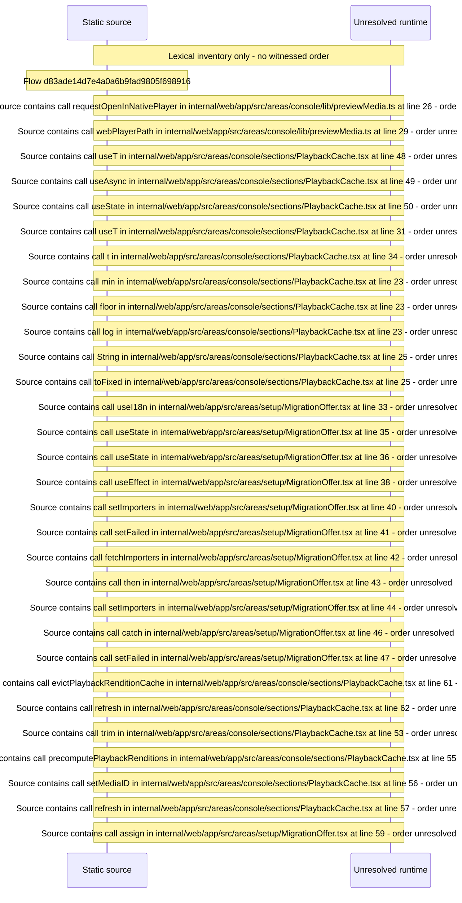

# Unreached code: unmounted modules and GraphQL operations no UI calls — flow-diagram

Source revision: e417fb394873a04fbd27fb8d5bcbca5484c8747f. Trust: generated. Freshness: pinned source; run docs flows check for a later revision.

<!-- flowdocs:paragraph:74b00a777fe8dc79a08c7bd7525e8607 -->
Static source inventory only; sequence and runtime ordering are unresolved\.

Source: internal/web/app/src/areas/console/lib/previewMedia\.ts:25; symbol: routeConsolePreview; span SHA256: f927553db806fdf01e1315eb5d2ebb2dcd20f9f8ebc93ee60fac35fbebc07a89.

