# Player route: lazy load, timestamp links, info overlay, audio stage — flow-diagram

Source revision: e417fb394873a04fbd27fb8d5bcbca5484c8747f. Trust: generated. Freshness: pinned source; run docs flows check for a later revision.

<!-- flowdocs:paragraph:8f08f6465223fb0da070854aacfafa6d -->
Static source inventory only; sequence and runtime ordering are unresolved\.

Source: internal/web/app/src/areas/viewer/pages/PlayerPage\.tsx:41; symbol: PlayerPage; span SHA256: 23cf3dbe101367b8eb37216ba93bd2f3395527a8ecb2a14a2b116775aff2b593.

```mermaid
sequenceDiagram
    participant S as Static source
    participant U as Unresolved runtime
    Note over S,U: Lexical inventory only - no witnessed order
    Note over S: Flow d950458d8d21d8cd6527c9e9982e3442
    Note over S,U: Source contains call useT in internal/web/app/src/areas/viewer/pages/PlayerPage.tsx at line 42 - order unresolved
    Note over S,U: Source contains call useDisplayLocale in internal/web/app/src/areas/viewer/pages/PlayerPage.tsx at line 43 - order unresolved
    Note over S,U: Source contains call useNavigate in internal/web/app/src/areas/viewer/pages/PlayerPage.tsx at line 44 - order unresolved
    Note over S,U: Source contains call useLocation in internal/web/app/src/areas/viewer/pages/PlayerPage.tsx at line 45 - order unresolved
    Note over S,U: Source contains call useParams in internal/web/app/src/areas/viewer/pages/PlayerPage.tsx at line 46 - order unresolved
    Note over S,U: Source contains call useSession in internal/web/app/src/areas/viewer/pages/PlayerPage.tsx at line 47 - order unresolved
    Note over S,U: Source contains call useViewerIdentity in internal/web/app/src/areas/viewer/pages/PlayerPage.tsx at line 48 - order unresolved
    Note over S,U: Source contains call useState in internal/web/app/src/areas/viewer/pages/PlayerPage.tsx at line 50 - order unresolved
    Note over S,U: Source contains call readPlayerNavState in internal/web/app/src/areas/viewer/pages/PlayerPage.tsx at line 57 - order unresolved
    Note over S,U: Source contains call parseTimestampParam in internal/web/app/src/areas/viewer/pages/PlayerPage.tsx at line 61 - order unresolved
    Note over S,U: Source contains call URLSearchParams in internal/web/app/src/areas/viewer/pages/PlayerPage.tsx at line 61 - order unresolved
    Note over S,U: Source contains call get in internal/web/app/src/areas/viewer/pages/PlayerPage.tsx at line 61 - order unresolved
    Note over S,U: Source contains call queueNeighbours in internal/web/app/src/areas/viewer/pages/PlayerPage.tsx at line 62 - order unresolved
    Note over S,U: Source contains call usePlayer in internal/web/app/src/areas/viewer/pages/PlayerPage.tsx at line 64 - order unresolved
    Note over S,U: Source contains call t in internal/web/app/src/areas/viewer/pages/PlayerPage.tsx at line 67 - order unresolved
    Note over S,U: Source contains call t in internal/web/app/src/areas/viewer/pages/PlayerPage.tsx at line 68 - order unresolved
    Note over S,U: Source contains call t in internal/web/app/src/areas/viewer/pages/PlayerPage.tsx at line 69 - order unresolved
    Note over S,U: Source contains call t in internal/web/app/src/areas/viewer/pages/PlayerPage.tsx at line 70 - order unresolved
    Note over S,U: Source contains call t in internal/web/app/src/areas/viewer/pages/PlayerPage.tsx at line 71 - order unresolved
    Note over S,U: Source contains call t in internal/web/app/src/areas/viewer/pages/PlayerPage.tsx at line 72 - order unresolved
    Note over S,U: Source contains call t in internal/web/app/src/areas/viewer/pages/PlayerPage.tsx at line 73 - order unresolved
    Note over S,U: Source contains call t in internal/web/app/src/areas/viewer/pages/PlayerPage.tsx at line 74 - order unresolved
    Note over S,U: Source contains call t in internal/web/app/src/areas/viewer/pages/PlayerPage.tsx at line 75 - order unresolved
    Note over S,U: Source contains call t in internal/web/app/src/areas/viewer/pages/PlayerPage.tsx at line 76 - order unresolved
    Note over S,U: Source contains call t in internal/web/app/src/areas/viewer/pages/PlayerPage.tsx at line 77 - order unresolved
    Note over S,U: Source contains call t in internal/web/app/src/areas/viewer/pages/PlayerPage.tsx at line 78 - order unresolved
    Note over S,U: Source contains call t in internal/web/app/src/areas/viewer/pages/PlayerPage.tsx at line 79 - order unresolved
    Note over S,U: Source contains call t in internal/web/app/src/areas/viewer/pages/PlayerPage.tsx at line 80 - order unresolved
    Note over S,U: Source contains call useMediaLoading in internal/web/app/src/areas/viewer/pages/PlayerPage.tsx at line 89 - order unresolved
    Note over S,U: Source contains call find in internal/web/app/src/areas/viewer/pages/PlayerPage.tsx at line 94 - order unresolved
    Note over S,U: Source contains call resolvePreferences in internal/web/app/src/areas/viewer/pages/PlayerPage.tsx at line 96 - order unresolved
    Note over S,U: Source contains call skipIntervalOverrideValue in internal/web/app/src/areas/viewer/pages/PlayerPage.tsx at line 97 - order unresolved
    Note over S,U: Source contains call displayString in internal/web/app/src/areas/viewer/pages/PlayerPage.tsx at line 99 - order unresolved
    Note over S,U: Source contains call t in internal/web/app/src/areas/viewer/pages/PlayerPage.tsx at line 102 - order unresolved
    Note over S,U: Source contains call findIndex in internal/web/app/src/areas/viewer/pages/PlayerPage.tsx at line 112 - order unresolved
    Note over S,U: Source contains call t in internal/web/app/src/areas/viewer/pages/PlayerPage.tsx at line 115 - order unresolved
    Note over S,U: Source contains call useChromeAutoHide in internal/web/app/src/areas/viewer/pages/PlayerPage.tsx at line 118 - order unresolved
    Note over S,U: Source contains call useCallback in internal/web/app/src/areas/viewer/pages/PlayerPage.tsx at line 128 - order unresolved
    Note over S,U: Source contains call navigate in internal/web/app/src/areas/viewer/pages/PlayerPage.tsx at line 130 - order unresolved
    Note over S,U: Source contains call useCallback in internal/web/app/src/areas/viewer/pages/PlayerPage.tsx at line 140 - order unresolved
    Note over S,U: Source contains call find in internal/web/app/src/areas/viewer/pages/PlayerPage.tsx at line 142 - order unresolved
    Note over S,U: Source contains call playItem in internal/web/app/src/areas/viewer/pages/PlayerPage.tsx at line 143 - order unresolved
    Note over S,U: Source contains call useCallback in internal/web/app/src/areas/viewer/pages/PlayerPage.tsx at line 148 - order unresolved
    Note over S,U: Source contains call playItem in internal/web/app/src/areas/viewer/pages/PlayerPage.tsx at line 150 - order unresolved
    Note over S,U: Source contains call URL in internal/web/app/src/areas/viewer/pages/PlayerPage.tsx at line 404 - order unresolved
    Note over S,U: Source contains call set in internal/web/app/src/areas/viewer/pages/PlayerPage.tsx at line 408 - order unresolved
    Note over S,U: Source contains call String in internal/web/app/src/areas/viewer/pages/PlayerPage.tsx at line 408 - order unresolved
    Note over S,U: Source contains call max in internal/web/app/src/areas/viewer/pages/PlayerPage.tsx at line 408 - order unresolved
    Note over S,U: Source contains call floor in internal/web/app/src/areas/viewer/pages/PlayerPage.tsx at line 408 - order unresolved
    Note over S,U: Source contains call Number in internal/web/app/src/areas/viewer/pages/PlayerPage.tsx at line 399 - order unresolved
    Note over S,U: Source contains call isFinite in internal/web/app/src/areas/viewer/pages/PlayerPage.tsx at line 400 - order unresolved
    Note over S,U: Source contains call floor in internal/web/app/src/areas/viewer/pages/PlayerPage.tsx at line 400 - order unresolved
    Note over S,U: Source contains call useState in internal/web/app/src/areas/viewer/player/AudioStage.tsx at line 23 - order unresolved
    Note over S,U: Source contains call creditLine in internal/web/app/src/areas/viewer/player/AudioStage.tsx at line 25 - order unresolved
    Note over S,U: Source contains call creditLine in internal/web/app/src/areas/viewer/player/AudioStage.tsx at line 26 - order unresolved
    Note over S,U: Source contains call creditLine in internal/web/app/src/areas/viewer/player/AudioStage.tsx at line 27 - order unresolved
    Note over S,U: Source contains call setFailedURL in internal/web/app/src/areas/viewer/player/AudioStage.tsx at line 44 - order unresolved
    Note over S,U: Source contains call replace in internal/web/app/src/areas/viewer/player/AudioStage.tsx at line 72 - order unresolved
    Note over S,U: Source contains call useT in internal/web/app/src/areas/viewer/player/InfoOverlay.tsx at line 36 - order unresolved
    Note over S,U: Source contains call buildRouteDetailModel in internal/web/app/src/areas/viewer/player/InfoOverlay.tsx at line 38 - order unresolved
    Note over S,U: Source contains call t in internal/web/app/src/areas/viewer/player/InfoOverlay.tsx at line 44 - order unresolved
    Note over S,U: Source contains call t in internal/web/app/src/areas/viewer/player/InfoOverlay.tsx at line 45 - order unresolved
    Note over S,U: Source contains call t in internal/web/app/src/areas/viewer/player/InfoOverlay.tsx at line 46 - order unresolved
    Note over S,U: Source contains call t in internal/web/app/src/areas/viewer/player/InfoOverlay.tsx at line 47 - order unresolved
    Note over S,U: Source contains call t in internal/web/app/src/areas/viewer/player/InfoOverlay.tsx at line 48 - order unresolved
    Note over S,U: Source contains call t in internal/web/app/src/areas/viewer/player/InfoOverlay.tsx at line 49 - order unresolved
    Note over S,U: Source contains call t in internal/web/app/src/areas/viewer/player/InfoOverlay.tsx at line 50 - order unresolved
    Note over S,U: Source contains call t in internal/web/app/src/areas/viewer/player/InfoOverlay.tsx at line 51 - order unresolved
    Note over S,U: Source contains call t in internal/web/app/src/areas/viewer/player/InfoOverlay.tsx at line 52 - order unresolved
    Note over S,U: Source contains call t in internal/web/app/src/areas/viewer/player/InfoOverlay.tsx at line 59 - order unresolved
    Note over S,U: Source contains call t in internal/web/app/src/areas/viewer/player/InfoOverlay.tsx at line 63 - order unresolved
    Note over S,U: Source contains call t in internal/web/app/src/areas/viewer/player/InfoOverlay.tsx at line 70 - order unresolved
    Note over S,U: Source contains call t in internal/web/app/src/areas/viewer/player/InfoOverlay.tsx at line 73 - order unresolved
    Note over S,U: Source contains call t in internal/web/app/src/areas/viewer/player/InfoOverlay.tsx at line 76 - order unresolved
    Note over S,U: Source contains call map in internal/web/app/src/areas/viewer/player/InfoOverlay.tsx at line 78 - order unresolved
    Note over S,U: Source contains call t in internal/web/app/src/areas/viewer/player/InfoOverlay.tsx at line 80 - order unresolved
    Note over S,U: Source contains call preload in internal/web/app/src/areas/viewer/player/preload.ts at line 9 - order unresolved
    Note over S,U: Source contains call catch in internal/web/app/src/areas/viewer/player/preload.ts at line 9 - order unresolved
    Note over S,U: Source contains call navigate in internal/web/app/src/areas/viewer/pages/PlayerPage.tsx at line 287 - order unresolved
    Note over S,U: Source contains call useMemo in internal/web/app/src/areas/viewer/pages/PlayerPage.tsx at line 155 - order unresolved
    Note over S,U: Source contains call goToQueueItem in internal/web/app/src/areas/viewer/pages/PlayerPage.tsx at line 156 - order unresolved
    Note over S,U: Source contains call advanceToNext in internal/web/app/src/areas/viewer/pages/PlayerPage.tsx at line 157 - order unresolved
    Note over S,U: Source contains call useMemo in internal/web/app/src/areas/viewer/pages/PlayerPage.tsx at line 166 - order unresolved
    Note over S,U: Source contains call goToQueueItem in internal/web/app/src/areas/viewer/pages/PlayerPage.tsx at line 167 - order unresolved
    Note over S,U: Source contains call playItem in internal/web/app/src/areas/viewer/pages/PlayerPage.tsx at line 168 - order unresolved
```

