# Manage subscriptions and retention kinds — flow-diagram

Source revision: d658ad5b71dcb67da0ae540d6d5ff80ca8efefd5. Trust: generated. Freshness: pinned source; run docs flows check for a later revision.

<!-- flowdocs:paragraph:3812876bea2833d22454b7951b6e7f21 -->
Static source inventory only; sequence and runtime ordering are unresolved\.

Source: internal/web/app/src/areas/manage/pages/SubscriptionsPage\.tsx:44; symbol: RETENTION\_KINDS; span SHA256: 5dd4f70d180d5a5bf45e288263059770089c15c92e9c9ebac0706e8f2e0321a6.

```mermaid
sequenceDiagram
    participant S as Static source
    participant U as Unresolved runtime
    Note over S,U: Lexical inventory only - no witnessed order
    Note over S: Flow e07cf6403700ca3de20c5f8ee4e8ef12
    Note over S,U: Source contains call useT at line 257 - order unresolved
    Note over S,U: Source contains call useState at line 258 - order unresolved
    Note over S,U: Source contains call useState at line 259 - order unresolved
    Note over S,U: Source contains call String at line 260 - order unresolved
    Note over S,U: Source contains call t at line 274 - order unresolved
    Note over S,U: Source contains call t at line 275 - order unresolved
    Note over S,U: Source contains call map at line 280 - order unresolved
    Note over S,U: Source contains call t at line 282 - order unresolved
    Note over S,U: Source contains call t at line 293 - order unresolved
    Note over S,U: Source contains call t at line 294 - order unresolved
    Note over S,U: Source contains call setN at line 296 - order unresolved
    Note over S,U: Source contains call onSaveRetention at line 304 - order unresolved
    Note over S,U: Source contains call Number at line 304 - order unresolved
    Note over S,U: Source contains call t at line 306 - order unresolved
    Note over S,U: Source contains call t at line 314 - order unresolved
    Note over S,U: Source contains call t at line 319 - order unresolved
    Note over S,U: Source contains call t at line 325 - order unresolved
    Note over S,U: Source contains call onRemove at line 326 - order unresolved
    Note over S,U: Source contains call t at line 327 - order unresolved
    Note over S,U: Source contains call useT at line 56 - order unresolved
    Note over S,U: Source contains call useSession at line 57 - order unresolved
    Note over S,U: Source contains call useState at line 60 - order unresolved
    Note over S,U: Source contains call useState at line 62 - order unresolved
    Note over S,U: Source contains call useState at line 63 - order unresolved
    Note over S,U: Source contains call useState at line 64 - order unresolved
    Note over S,U: Source contains call useState at line 65 - order unresolved
    Note over S,U: Source contains call useRef at line 66 - order unresolved
    Note over S,U: Source contains call useRef at line 67 - order unresolved
    Note over S,U: Source contains call useEffect at line 71 - order unresolved
    Note over S,U: Source contains call setLibraryID at line 72 - order unresolved
    Note over S,U: Source contains call useCallback at line 75 - order unresolved
    Note over S,U: Source contains call async at line 76 - order unresolved
    Note over S,U: Source contains call setError at line 78 - order unresolved
    Note over S,U: Source contains call setSubscriptions at line 79 - order unresolved
    Note over S,U: Source contains call fetchSubscriptions at line 82 - order unresolved
    Note over S,U: Source contains call setSubscriptions at line 83 - order unresolved
    Note over S,U: Source contains call setError at line 85 - order unresolved
    Note over S,U: Source contains call t at line 85 - order unresolved
    Note over S,U: Source contains call useEffect at line 91 - order unresolved
    Note over S,U: Source contains call load at line 92 - order unresolved
    Note over S,U: Source contains call useCallback at line 98 - order unresolved
    Note over S,U: Source contains call async at line 99 - order unresolved
    Note over S,U: Source contains call load at line 101 - order unresolved
    Note over S,U: Source contains call async at line 107 - order unresolved
    Note over S,U: Source contains call setError at line 108 - order unresolved
    Note over S,U: Source contains call trim at line 109 - order unresolved
    Note over S,U: Source contains call setError at line 112 - order unresolved
    Note over S,U: Source contains call t at line 112 - order unresolved
    Note over S,U: Source contains call addSubscription at line 116 - order unresolved
    Note over S,U: Source contains call trim at line 119 - order unresolved
    Note over S,U: Source contains call trim at line 120 - order unresolved
    Note over S,U: Source contains call setFeedURL at line 123 - order unresolved
    Note over S,U: Source contains call setRoot at line 124 - order unresolved
    Note over S,U: Source contains call setAuthHeader at line 125 - order unresolved
    Note over S,U: Source contains call refreshMutationLibrary at line 126 - order unresolved
    Note over S,U: Source contains call setError at line 130 - order unresolved
    Note over S,U: Source contains call t at line 130 - order unresolved
    Note over S,U: Source contains call async at line 148 - order unresolved
    Note over S,U: Source contains call setError at line 150 - order unresolved
    Note over S,U: Source contains call removeSubscription at line 152 - order unresolved
    Note over S,U: Source contains call refreshMutationLibrary at line 153 - order unresolved
    Note over S,U: Source contains call setError at line 155 - order unresolved
    Note over S,U: Source contains call t at line 155 - order unresolved
    Note over S,U: Source contains call async at line 135 - order unresolved
    Note over S,U: Source contains call setError at line 137 - order unresolved
    Note over S,U: Source contains call setSubscriptionRetention at line 139 - order unresolved
    Note over S,U: Source contains call refreshMutationLibrary at line 140 - order unresolved
    Note over S,U: Source contains call setError at line 143 - order unresolved
    Note over S,U: Source contains call t at line 143 - order unresolved
```

