# Console remote access: certificate, relay, direct connection, watch\-away guide — flow-diagram

Source revision: e417fb394873a04fbd27fb8d5bcbca5484c8747f. Trust: generated. Freshness: pinned source; run docs flows check for a later revision.

<!-- flowdocs:paragraph:786209b29f4d10a61de26299e4f95511 -->
Static source inventory only; sequence and runtime ordering are unresolved\.

Source: internal/web/app/src/areas/console/sections/RemoteAccess\.tsx:149; symbol: Field; span SHA256: d5eb2ee4b24ae610bd1aa1313648079d4b81ffbf1836ad03166d202111aef4e4.

```mermaid
sequenceDiagram
    participant S as Static source
    participant U as Unresolved runtime
    Note over S,U: Lexical inventory only - no witnessed order
    Note over S: Flow e40bf913ff2ba00e488661ed0764fddb
    Note over S,U: Source contains call useT at line 150 - order unresolved
    Note over S,U: Source contains call t at line 154 - order unresolved
    Note over S,U: Source contains call useT at line 199 - order unresolved
    Note over S,U: Source contains call t at line 207 - order unresolved
    Note over S,U: Source contains call t at line 209 - order unresolved
    Note over S,U: Source contains call useT at line 331 - order unresolved
    Note over S,U: Source contains call useAsync at line 332 - order unresolved
    Note over S,U: Source contains call connectionClassLabels at line 333 - order unresolved
    Note over S,U: Source contains call refresh at line 341 - order unresolved
    Note over S,U: Source contains call t at line 343 - order unresolved
    Note over S,U: Source contains call map at line 354 - order unresolved
    Note over S,U: Source contains call t at line 356 - order unresolved
    Note over S,U: Source contains call t at line 363 - order unresolved
    Note over S,U: Source contains call t at line 368 - order unresolved
    Note over S,U: Source contains call useT at line 233 - order unresolved
    Note over S,U: Source contains call find at line 235 - order unresolved
    Note over S,U: Source contains call currentEndpointKind at line 236 - order unresolved
    Note over S,U: Source contains call directState at line 242 - order unresolved
    Note over S,U: Source contains call t at line 248 - order unresolved
    Note over S,U: Source contains call t at line 249 - order unresolved
    Note over S,U: Source contains call t at line 258 - order unresolved
    Note over S,U: Source contains call t at line 261 - order unresolved
    Note over S,U: Source contains call t at line 263 - order unresolved
    Note over S,U: Source contains call t at line 269 - order unresolved
    Note over S,U: Source contains call t at line 274 - order unresolved
    Note over S,U: Source contains call refresh at line 277 - order unresolved
    Note over S,U: Source contains call t at line 279 - order unresolved
    Note over S,U: Source contains call t at line 287 - order unresolved
    Note over S,U: Source contains call t at line 292 - order unresolved
    Note over S,U: Source contains call t at line 294 - order unresolved
    Note over S,U: Source contains call t at line 303 - order unresolved
    Note over S,U: Source contains call t at line 306 - order unresolved
    Note over S,U: Source contains call t at line 312 - order unresolved
    Note over S,U: Source contains call t at line 314 - order unresolved
    Note over S,U: Source contains call t at line 320 - order unresolved
    Note over S,U: Source contains call from at line 161 - order unresolved
    Note over S,U: Source contains call Set at line 162 - order unresolved
    Note over S,U: Source contains call map at line 164 - order unresolved
    Note over S,U: Source contains call filter at line 165 - order unresolved
    Note over S,U: Source contains call Boolean at line 165 - order unresolved
    Note over S,U: Source contains call URL at line 172 - order unresolved
    Note over S,U: Source contains call toLowerCase at line 172 - order unresolved
```

