# Console remote access: certificate, relay, direct connection, watch\-away guide — flow-diagram

Source revision: 6742c2361d684c662e9ccb84d344a2200c377582. Trust: generated. Freshness: pinned source; run docs flows check for a later revision.

<!-- flowdocs:paragraph:786209b29f4d10a61de26299e4f95511 -->
Static source inventory only; sequence and runtime ordering are unresolved\.

Source: internal/web/app/src/areas/console/sections/RemoteAccess\.tsx:60; symbol: CERT\_STATE; span SHA256: 34c6e6df39126b1ed055c8538ad882ae2190a0b5ad63d03e6e98e2ef9e0b8cab.

```mermaid
sequenceDiagram
    participant S as Static source
    participant U as Unresolved runtime
    Note over S,U: Lexical inventory only - no witnessed order
    Note over S: Flow e40bf913ff2ba00e488661ed0764fddb
    Note over S,U: Source contains call useT at line 141 - order unresolved
    Note over S,U: Source contains call t at line 145 - order unresolved
    Note over S,U: Source contains call useT at line 190 - order unresolved
    Note over S,U: Source contains call t at line 196 - order unresolved
    Note over S,U: Source contains call t at line 198 - order unresolved
    Note over S,U: Source contains call useT at line 320 - order unresolved
    Note over S,U: Source contains call useAsync at line 321 - order unresolved
    Note over S,U: Source contains call useDisplayLocale at line 322 - order unresolved
    Note over S,U: Source contains call connectionClassLabels at line 323 - order unresolved
    Note over S,U: Source contains call refresh at line 330 - order unresolved
    Note over S,U: Source contains call t at line 332 - order unresolved
    Note over S,U: Source contains call t at line 343 - order unresolved
    Note over S,U: Source contains call ListFormat at line 345 - order unresolved
    Note over S,U: Source contains call format at line 345 - order unresolved
    Note over S,U: Source contains call map at line 346 - order unresolved
    Note over S,U: Source contains call t at line 346 - order unresolved
    Note over S,U: Source contains call t at line 353 - order unresolved
    Note over S,U: Source contains call t at line 358 - order unresolved
    Note over S,U: Source contains call useT at line 222 - order unresolved
    Note over S,U: Source contains call find at line 224 - order unresolved
    Note over S,U: Source contains call currentEndpointKind at line 225 - order unresolved
    Note over S,U: Source contains call directState at line 231 - order unresolved
    Note over S,U: Source contains call t at line 237 - order unresolved
    Note over S,U: Source contains call t at line 238 - order unresolved
    Note over S,U: Source contains call t at line 247 - order unresolved
    Note over S,U: Source contains call t at line 250 - order unresolved
    Note over S,U: Source contains call t at line 252 - order unresolved
    Note over S,U: Source contains call t at line 258 - order unresolved
    Note over S,U: Source contains call t at line 263 - order unresolved
    Note over S,U: Source contains call refresh at line 266 - order unresolved
    Note over S,U: Source contains call t at line 268 - order unresolved
    Note over S,U: Source contains call t at line 276 - order unresolved
    Note over S,U: Source contains call t at line 281 - order unresolved
    Note over S,U: Source contains call t at line 283 - order unresolved
    Note over S,U: Source contains call Boolean at line 290 - order unresolved
    Note over S,U: Source contains call t at line 292 - order unresolved
    Note over S,U: Source contains call t at line 294 - order unresolved
    Note over S,U: Source contains call t at line 300 - order unresolved
    Note over S,U: Source contains call t at line 302 - order unresolved
    Note over S,U: Source contains call t at line 308 - order unresolved
    Note over S,U: Source contains call from at line 152 - order unresolved
    Note over S,U: Source contains call Set at line 153 - order unresolved
    Note over S,U: Source contains call map at line 155 - order unresolved
    Note over S,U: Source contains call filter at line 156 - order unresolved
    Note over S,U: Source contains call Boolean at line 156 - order unresolved
    Note over S,U: Source contains call URL at line 163 - order unresolved
    Note over S,U: Source contains call toLowerCase at line 163 - order unresolved
```

