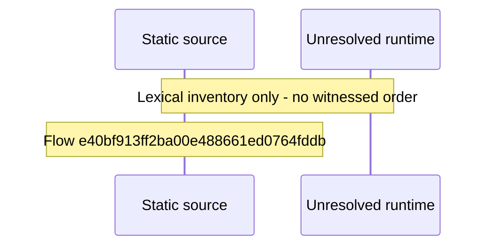

# Console remote access: certificate, relay, direct connection, watch\-away guide — flow-diagram

Source revision: 5ffe7939da2318f5153b1a20d0ef6ef94deef162. Trust: generated. Freshness: pinned source; run docs flows check for a later revision.

<!-- flowdocs:paragraph:786209b29f4d10a61de26299e4f95511 -->
Static source inventory only; sequence and runtime ordering are unresolved\.

Source: internal/web/app/src/lib/graphql/console\.ts:53; symbol: fetchRemoteAccess; span SHA256: 098987e60ab4f38516105c38f9b7ded03f1f0f85716da05bc7b9010ba507ded5.

