# App shell chrome: header, library sidebar, account menu, phone layout — flow-diagram

Source revision: 6742c2361d684c662e9ccb84d344a2200c377582. Trust: generated. Freshness: pinned source; run docs flows check for a later revision.

<!-- flowdocs:paragraph:d615ec7ce0e551eeb17c139b8e1f7423 -->
Static source inventory only; sequence and runtime ordering are unresolved\.

Source: internal/web/app/src/components/chrome/AccountMenu\.tsx:13; symbol: AccountMenu; span SHA256: 3ae2d92653644346e79885513d786afc911035dc3291892385bd9270402e1e95.

```mermaid
sequenceDiagram
    participant S as Static source
    participant U as Unresolved runtime
    Note over S,U: Lexical inventory only - no witnessed order
    Note over S: Flow e6c78d6d240525f99af728fe632d5b32
    Note over S,U: Source contains call useT in internal/web/app/src/components/chrome/AccountMenu.tsx at line 14 - order unresolved
    Note over S,U: Source contains call useLocation in internal/web/app/src/components/chrome/AccountMenu.tsx at line 15 - order unresolved
    Note over S,U: Source contains call useSession in internal/web/app/src/components/chrome/AccountMenu.tsx at line 16 - order unresolved
    Note over S,U: Source contains call useState in internal/web/app/src/components/chrome/AccountMenu.tsx at line 17 - order unresolved
    Note over S,U: Source contains call useId in internal/web/app/src/components/chrome/AccountMenu.tsx at line 18 - order unresolved
    Note over S,U: Source contains call find in internal/web/app/src/components/chrome/AccountMenu.tsx at line 22 - order unresolved
    Note over S,U: Source contains call t in internal/web/app/src/components/chrome/AccountMenu.tsx at line 23 - order unresolved
    Note over S,U: Source contains call useEffect in internal/web/app/src/components/chrome/AccountMenu.tsx at line 31 - order unresolved
    Note over S,U: Source contains call setOpen in internal/web/app/src/components/chrome/AccountMenu.tsx at line 32 - order unresolved
    Note over S,U: Source contains call useEffect in internal/web/app/src/components/chrome/AccountMenu.tsx at line 35 - order unresolved
    Note over S,U: Source contains call useT in internal/web/app/src/components/chrome/AppShell.tsx at line 68 - order unresolved
    Note over S,U: Source contains call useLocation in internal/web/app/src/components/chrome/AppShell.tsx at line 69 - order unresolved
    Note over S,U: Source contains call useRegister in internal/web/app/src/components/chrome/AppShell.tsx at line 70 - order unresolved
    Note over S,U: Source contains call useSession in internal/web/app/src/components/chrome/AppShell.tsx at line 71 - order unresolved
    Note over S,U: Source contains call useState in internal/web/app/src/components/chrome/AppShell.tsx at line 72 - order unresolved
    Note over S,U: Source contains call getBeamfallHost in internal/web/app/src/components/chrome/AppShell.tsx at line 73 - order unresolved
    Note over S,U: Source contains call useId in internal/web/app/src/components/chrome/AppShell.tsx at line 74 - order unresolved
    Note over S,U: Source contains call usePhoneLayout in internal/web/app/src/components/chrome/AppShell.tsx at line 76 - order unresolved
    Note over S,U: Source contains call useState in internal/web/app/src/components/chrome/AppShell.tsx at line 77 - order unresolved
    Note over S,U: Source contains call useState in internal/web/app/src/components/chrome/AppShell.tsx at line 78 - order unresolved
    Note over S,U: Source contains call useEffect in internal/web/app/src/components/chrome/AppShell.tsx at line 90 - order unresolved
    Note over S,U: Source contains call setDrawerOpen in internal/web/app/src/components/chrome/AppShell.tsx at line 91 - order unresolved
    Note over S,U: Source contains call useEffect in internal/web/app/src/components/chrome/AppShell.tsx at line 93 - order unresolved
    Note over S,U: Source contains call setDrawerOpen in internal/web/app/src/components/chrome/AppShell.tsx at line 94 - order unresolved
    Note over S,U: Source contains call useEffect in internal/web/app/src/components/chrome/AppShell.tsx at line 96 - order unresolved
    Note over S,U: Source contains call getItem in internal/web/app/src/components/chrome/AppShell.tsx at line 23 - order unresolved
    Note over S,U: Source contains call matchMedia in internal/web/app/src/components/chrome/AppShell.tsx at line 29 - order unresolved
    Note over S,U: Source contains call useState in internal/web/app/src/components/chrome/AppShell.tsx at line 42 - order unresolved
    Note over S,U: Source contains call matchMedia in internal/web/app/src/components/chrome/AppShell.tsx at line 43 - order unresolved
    Note over S,U: Source contains call useEffect in internal/web/app/src/components/chrome/AppShell.tsx at line 45 - order unresolved
    Note over S,U: Source contains call matchMedia in internal/web/app/src/components/chrome/AppShell.tsx at line 47 - order unresolved
    Note over S,U: Source contains call setItem in internal/web/app/src/components/chrome/AppShell.tsx at line 35 - order unresolved
    Note over S,U: Source contains call useT in internal/web/app/src/components/chrome/LibrarySidebar.tsx at line 34 - order unresolved
    Note over S,U: Source contains call useDisplayLocale in internal/web/app/src/components/chrome/LibrarySidebar.tsx at line 35 - order unresolved
    Note over S,U: Source contains call Map in internal/web/app/src/components/chrome/LibrarySidebar.tsx at line 36 - order unresolved
    Note over S,U: Source contains call map in internal/web/app/src/components/chrome/LibrarySidebar.tsx at line 36 - order unresolved
    Note over S,U: Source contains call filter in internal/web/app/src/components/chrome/LibrarySidebar.tsx at line 37 - order unresolved
    Note over S,U: Source contains call filter in internal/web/app/src/components/chrome/LibrarySidebar.tsx at line 38 - order unresolved
    Note over S,U: Source contains call find in internal/web/app/src/components/chrome/LibrarySidebar.tsx at line 40 - order unresolved
    Note over S,U: Source contains call setOpen in internal/web/app/src/components/chrome/AccountMenu.tsx at line 42 - order unresolved
    Note over S,U: Source contains call focus in internal/web/app/src/components/chrome/AccountMenu.tsx at line 43 - order unresolved
    Note over S,U: Source contains call contains in internal/web/app/src/components/chrome/AccountMenu.tsx at line 38 - order unresolved
    Note over S,U: Source contains call setOpen in internal/web/app/src/components/chrome/AccountMenu.tsx at line 38 - order unresolved
    Note over S,U: Source contains call setPhone in internal/web/app/src/components/chrome/AppShell.tsx at line 48 - order unresolved
    Note over S,U: Source contains call setDrawerOpen in internal/web/app/src/components/chrome/AppShell.tsx at line 100 - order unresolved
    Note over S,U: Source contains call getElementById in internal/web/app/src/components/chrome/AppShell.tsx at line 101 - order unresolved
    Note over S,U: Source contains call contains in internal/web/app/src/components/chrome/AppShell.tsx at line 101 - order unresolved
    Note over S,U: Source contains call focus in internal/web/app/src/components/chrome/AppShell.tsx at line 102 - order unresolved
    Note over S,U: Source contains call refreshUnreadNotifications in internal/web/app/src/components/chrome/AppShell.tsx at line 143 - order unresolved
    Note over S,U: Source contains call useCallback in internal/web/app/src/components/chrome/AppShell.tsx at line 120 - order unresolved
    Note over S,U: Source contains call async in internal/web/app/src/components/chrome/AppShell.tsx at line 120 - order unresolved
    Note over S,U: Source contains call setUnreadNotifications in internal/web/app/src/components/chrome/AppShell.tsx at line 122 - order unresolved
    Note over S,U: Source contains call fetchNotifications in internal/web/app/src/components/chrome/AppShell.tsx at line 126 - order unresolved
    Note over S,U: Source contains call setUnreadNotifications in internal/web/app/src/components/chrome/AppShell.tsx at line 130 - order unresolved
    Note over S,U: Source contains call setUnreadNotifications in internal/web/app/src/components/chrome/AppShell.tsx at line 132 - order unresolved
    Note over S,U: Source contains call setDrawerOpen in internal/web/app/src/components/chrome/AppShell.tsx at line 111 - order unresolved
    Note over S,U: Source contains call setCollapsed in internal/web/app/src/components/chrome/AppShell.tsx at line 114 - order unresolved
    Note over S,U: Source contains call writeCollapsedPref in internal/web/app/src/components/chrome/AppShell.tsx at line 115 - order unresolved
    Note over S,U: Source contains call displayString in internal/web/app/src/components/chrome/LibrarySidebar.tsx at line 43 - order unresolved
    Note over S,U: Source contains call get in internal/web/app/src/components/chrome/LibrarySidebar.tsx at line 45 - order unresolved
    Note over S,U: Source contains call from in internal/web/app/src/components/chrome/LibrarySidebar.tsx at line 61 - order unresolved
    Note over S,U: Source contains call trim in internal/web/app/src/components/chrome/LibrarySidebar.tsx at line 61 - order unresolved
    Note over S,U: Source contains call toUpperCase in internal/web/app/src/components/chrome/LibrarySidebar.tsx at line 61 - order unresolved
```

