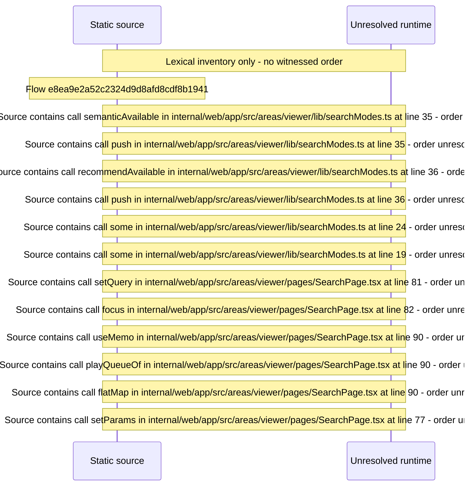

# Viewer search page: modes \(text, semantic, recommend\) and grouped results — flow-diagram

Source revision: 5ffe7939da2318f5153b1a20d0ef6ef94deef162. Trust: generated. Freshness: pinned source; run docs flows check for a later revision.

<!-- flowdocs:paragraph:7869fcca506e4a6b12f352808d0ad882 -->
Static source inventory only; sequence and runtime ordering are unresolved\.

Source: internal/web/app/src/areas/viewer/lib/searchModes\.ts:33; symbol: availableModes; span SHA256: 5f4a403960512cc16dcbe3f84c42469146299f7a38480c983ce1ffedf91d050c.

