# Viewer home and node browse: manifest layout, sections, hero — flow-diagram

Source revision: 6742c2361d684c662e9ccb84d344a2200c377582. Trust: generated. Freshness: pinned source; run docs flows check for a later revision.

<!-- flowdocs:paragraph:c37d8827514c653c240c6de3f5708c4e -->
Static source inventory only; sequence and runtime ordering are unresolved\.

Source: internal/web/app/src/areas/viewer/components/FilterBar\.tsx:11; symbol: FilterBar; span SHA256: a05dc4ffb51e8914d4a20896ac942330016731ce8a9440707383e1be4ee7eb00.

```mermaid
sequenceDiagram
    participant S as Static source
    participant U as Unresolved runtime
    Note over S,U: Lexical inventory only - no witnessed order
    Note over S: Flow e9b164fba48705f4d491078997ee3846
    Note over S,U: Source contains call useDisplayLocale in internal/web/app/src/areas/viewer/components/FilterBar.tsx at line 21 - order unresolved
    Note over S,U: Source contains call displayString in internal/web/app/src/areas/viewer/components/FilterBar.tsx at line 28 - order unresolved
    Note over S,U: Source contains call map in internal/web/app/src/areas/viewer/components/FilterBar.tsx at line 30 - order unresolved
    Note over S,U: Source contains call onToggle in internal/web/app/src/areas/viewer/components/FilterBar.tsx at line 37 - order unresolved
    Note over S,U: Source contains call displayString in internal/web/app/src/areas/viewer/components/FilterBar.tsx at line 40 - order unresolved
    Note over S,U: Source contains call useT in internal/web/app/src/areas/viewer/components/Hero.tsx at line 28 - order unresolved
    Note over S,U: Source contains call useDisplayLocale in internal/web/app/src/areas/viewer/components/Hero.tsx at line 29 - order unresolved
    Note over S,U: Source contains call useNavigate in internal/web/app/src/areas/viewer/components/Hero.tsx at line 30 - order unresolved
    Note over S,U: Source contains call useViewerIdentity in internal/web/app/src/areas/viewer/components/Hero.tsx at line 31 - order unresolved
    Note over S,U: Source contains call useState in internal/web/app/src/areas/viewer/components/Hero.tsx at line 32 - order unresolved
    Note over S,U: Source contains call artworkSlotURL in internal/web/app/src/areas/viewer/components/Hero.tsx at line 33 - order unresolved
    Note over S,U: Source contains call useViewerIdentity in internal/web/app/src/areas/viewer/components/HydratedSection.tsx at line 73 - order unresolved
    Note over S,U: Source contains call useEngagementEpoch in internal/web/app/src/areas/viewer/components/HydratedSection.tsx at line 76 - order unresolved
    Note over S,U: Source contains call sectionCacheKey in internal/web/app/src/areas/viewer/components/HydratedSection.tsx at line 77 - order unresolved
    Note over S,U: Source contains call useEffect in internal/web/app/src/areas/viewer/components/HydratedSection.tsx at line 82 - order unresolved
    Note over S,U: Source contains call AbortController in internal/web/app/src/areas/viewer/components/HydratedSection.tsx at line 84 - order unresolved
    Note over S,U: Source contains call setItems in internal/web/app/src/areas/viewer/components/HydratedSection.tsx at line 86 - order unresolved
    Note over S,U: Source contains call from in internal/web/app/src/areas/viewer/components/HydratedSection.tsx at line 163 - order unresolved
    Note over S,U: Source contains call map in internal/web/app/src/areas/viewer/components/HydratedSection.tsx at line 163 - order unresolved
    Note over S,U: Source contains call viewerCacheEntries in internal/web/app/src/areas/viewer/components/HydratedSection.tsx at line 35 - order unresolved
    Note over S,U: Source contains call startsWith in internal/web/app/src/areas/viewer/components/HydratedSection.tsx at line 36 - order unresolved
    Note over S,U: Source contains call find in internal/web/app/src/areas/viewer/components/HydratedSection.tsx at line 37 - order unresolved
    Note over S,U: Source contains call useT in internal/web/app/src/areas/viewer/components/LayoutView.tsx at line 36 - order unresolved
    Note over S,U: Source contains call useSession in internal/web/app/src/areas/viewer/components/LayoutView.tsx at line 37 - order unresolved
    Note over S,U: Source contains call useState in internal/web/app/src/areas/viewer/components/LayoutView.tsx at line 38 - order unresolved
    Note over S,U: Source contains call useRef in internal/web/app/src/areas/viewer/components/LayoutView.tsx at line 40 - order unresolved
    Note over S,U: Source contains call useRef in internal/web/app/src/areas/viewer/components/LayoutView.tsx at line 41 - order unresolved
    Note over S,U: Source contains call useRef in internal/web/app/src/areas/viewer/components/LayoutView.tsx at line 42 - order unresolved
    Note over S,U: Source contains call useT in internal/web/app/src/areas/viewer/components/SectionView.tsx at line 39 - order unresolved
    Note over S,U: Source contains call useDisplayLocale in internal/web/app/src/areas/viewer/components/SectionView.tsx at line 40 - order unresolved
    Note over S,U: Source contains call useNavigate in internal/web/app/src/areas/viewer/components/SectionView.tsx at line 41 - order unresolved
    Note over S,U: Source contains call useVirtualGrid in internal/web/app/src/areas/viewer/components/SectionView.tsx at line 56 - order unresolved
    Note over S,U: Source contains call slice in internal/web/app/src/areas/viewer/components/SectionView.tsx at line 65 - order unresolved
    Note over S,U: Source contains call focus in internal/web/app/src/areas/viewer/lib/renderFocus.ts at line 34 - order unresolved
    Note over S,U: Source contains call escape in internal/web/app/src/areas/viewer/lib/renderFocus.ts at line 43 - order unresolved
    Note over S,U: Source contains call replace in internal/web/app/src/areas/viewer/lib/renderFocus.ts at line 45 - order unresolved
    Note over S,U: Source contains call Set in internal/web/app/src/areas/viewer/lib/sections.ts at line 8 - order unresolved
    Note over S,U: Source contains call useT in internal/web/app/src/areas/viewer/pages/BrowsePage.tsx at line 21 - order unresolved
    Note over S,U: Source contains call useDisplayLocale in internal/web/app/src/areas/viewer/pages/BrowsePage.tsx at line 22 - order unresolved
    Note over S,U: Source contains call useParams in internal/web/app/src/areas/viewer/pages/BrowsePage.tsx at line 23 - order unresolved
    Note over S,U: Source contains call useSession in internal/web/app/src/areas/viewer/pages/BrowsePage.tsx at line 24 - order unresolved
    Note over S,U: Source contains call t in internal/web/app/src/areas/viewer/pages/BrowsePage.tsx at line 30 - order unresolved
    Note over S,U: Source contains call filter in internal/web/app/src/areas/viewer/pages/BrowsePage.tsx at line 38 - order unresolved
    Note over S,U: Source contains call find in internal/web/app/src/areas/viewer/pages/BrowsePage.tsx at line 43 - order unresolved
    Note over S,U: Source contains call find in internal/web/app/src/areas/viewer/pages/BrowsePage.tsx at line 44 - order unresolved
    Note over S,U: Source contains call navigate in internal/web/app/src/areas/viewer/components/Hero.tsx at line 40 - order unresolved
    Note over S,U: Source contains call navigate in internal/web/app/src/areas/viewer/components/Hero.tsx at line 44 - order unresolved
    Note over S,U: Source contains call entityLinkState in internal/web/app/src/areas/viewer/components/Hero.tsx at line 45 - order unresolved
    Note over S,U: Source contains call clearTimeout in internal/web/app/src/areas/viewer/components/HydratedSection.tsx at line 90 - order unresolved
    Note over S,U: Source contains call abort in internal/web/app/src/areas/viewer/components/HydratedSection.tsx at line 91 - order unresolved
    Note over S,U: Source contains call setItems in internal/web/app/src/areas/viewer/components/HydratedSection.tsx at line 96 - order unresolved
    Note over S,U: Source contains call useMemo in internal/web/app/src/areas/viewer/components/SectionView.tsx at line 66 - order unresolved
    Note over S,U: Source contains call playQueueOf in internal/web/app/src/areas/viewer/components/SectionView.tsx at line 66 - order unresolved
    Note over S,U: Source contains call seeAllTargetFor in internal/web/app/src/areas/viewer/pages/BrowsePage.tsx at line 48 - order unresolved
```

