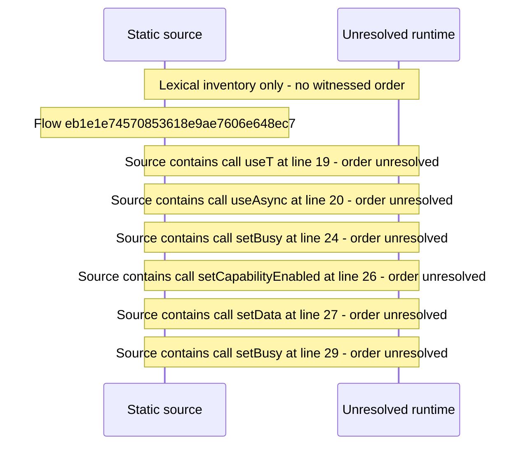

# Console identification and layout capabilities — flow-diagram

Source revision: 6742c2361d684c662e9ccb84d344a2200c377582. Trust: generated. Freshness: pinned source; run docs flows check for a later revision.

<!-- flowdocs:paragraph:b6216acf00de71903620456bc61f35b4 -->
Static source inventory only; sequence and runtime ordering are unresolved\.

Source: internal/web/app/src/areas/console/sections/Capabilities\.tsx:18; symbol: Capabilities; span SHA256: 32a8e7803eaa9f383ff15e6655ced66770a6b1877e806367d42975679b21d5a5.

