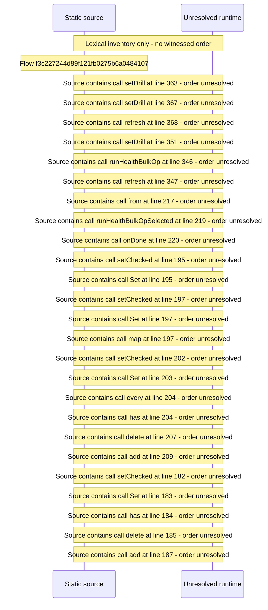

# Console library health: dimensions, drilldowns, bulk remediation — flow-diagram

Source revision: d442b4a6a38de86be0670669b3a3f6aa47e80b22. Trust: generated. Freshness: pinned source; run docs flows check for a later revision.

<!-- flowdocs:paragraph:14ce4f588cdaccb3c45c9e9c6e03edfe -->
Static source inventory only; sequence and runtime ordering are unresolved\.

Source: internal/web/app/src/areas/console/sections/Health\.tsx:77; symbol: aggregateCounts; span SHA256: 7e0dfa68a6bb9572a0a562d9d5fb58b2a524f2713ae7fedbea50435c151b98b9.

