# Console library health: dimensions, drilldowns, bulk remediation — flow-diagram

Source revision: d658ad5b71dcb67da0ae540d6d5ff80ca8efefd5. Trust: generated. Freshness: pinned source; run docs flows check for a later revision.

<!-- flowdocs:paragraph:14ce4f588cdaccb3c45c9e9c6e03edfe -->
Static source inventory only; sequence and runtime ordering are unresolved\.

Source: internal/web/app/src/areas/console/sections/Health\.tsx:89; symbol: CountCell; span SHA256: 7755a284d71063c1849828a63924ea2de0812913970f2d5dc57e5a2ff7667eda.

```mermaid
sequenceDiagram
    participant S as Static source
    participant U as Unresolved runtime
    Note over S,U: Lexical inventory only - no witnessed order
    Note over S: Flow f3c227244d89f121fb0275b6a0484107
    Note over S,U: Source contains call String at line 107 - order unresolved
    Note over S,U: Source contains call useT at line 340 - order unresolved
    Note over S,U: Source contains call useAsync at line 341 - order unresolved
    Note over S,U: Source contains call useT at line 146 - order unresolved
    Note over S,U: Source contains call Set at line 147 - order unresolved
    Note over S,U: Source contains call useAsync at line 154 - order unresolved
    Note over S,U: Source contains call resolve at line 157 - order unresolved
    Note over S,U: Source contains call fetchHealthDrilldown at line 158 - order unresolved
    Note over S,U: Source contains call useAsync at line 165 - order unresolved
    Note over S,U: Source contains call fetchDuplicateGroups at line 168 - order unresolved
    Note over S,U: Source contains call resolve at line 169 - order unresolved
    Note over S,U: Source contains call flatMap at line 177 - order unresolved
    Note over S,U: Source contains call slice at line 177 - order unresolved
    Note over S,U: Source contains call Boolean at line 179 - order unresolved
    Note over S,U: Source contains call setDrill at line 363 - order unresolved
    Note over S,U: Source contains call setDrill at line 367 - order unresolved
    Note over S,U: Source contains call refresh at line 368 - order unresolved
    Note over S,U: Source contains call setDrill at line 351 - order unresolved
    Note over S,U: Source contains call runHealthBulkOp at line 346 - order unresolved
    Note over S,U: Source contains call refresh at line 347 - order unresolved
    Note over S,U: Source contains call from at line 217 - order unresolved
    Note over S,U: Source contains call runHealthBulkOpSelected at line 219 - order unresolved
    Note over S,U: Source contains call onDone at line 220 - order unresolved
    Note over S,U: Source contains call setChecked at line 195 - order unresolved
    Note over S,U: Source contains call Set at line 195 - order unresolved
    Note over S,U: Source contains call setChecked at line 197 - order unresolved
    Note over S,U: Source contains call Set at line 197 - order unresolved
    Note over S,U: Source contains call map at line 197 - order unresolved
    Note over S,U: Source contains call setChecked at line 202 - order unresolved
    Note over S,U: Source contains call Set at line 203 - order unresolved
    Note over S,U: Source contains call every at line 204 - order unresolved
    Note over S,U: Source contains call has at line 204 - order unresolved
    Note over S,U: Source contains call delete at line 207 - order unresolved
    Note over S,U: Source contains call add at line 209 - order unresolved
    Note over S,U: Source contains call setChecked at line 182 - order unresolved
    Note over S,U: Source contains call Set at line 183 - order unresolved
    Note over S,U: Source contains call has at line 184 - order unresolved
    Note over S,U: Source contains call delete at line 185 - order unresolved
    Note over S,U: Source contains call add at line 187 - order unresolved
```

