# Viewer My Data / privacy: summary, event log, sessions, stream tokens, export — flow-diagram

Source revision: d658ad5b71dcb67da0ae540d6d5ff80ca8efefd5. Trust: generated. Freshness: pinned source; run docs flows check for a later revision.

<!-- flowdocs:paragraph:acc362561c516ccec31539cb78cf4958 -->
Static source inventory only; sequence and runtime ordering are unresolved\.

Source: internal/web/app/src/areas/viewer/pages/MyDataPage\.tsx:58; symbol: ALL\_LIBRARIES; span SHA256: eb3f07ba74a0fc603288f92ab1ebcf39cb6f259d1a28387ee36024bb03f48ee7.

```mermaid
sequenceDiagram
    participant S as Static source
    participant U as Unresolved runtime
    Note over S,U: Lexical inventory only - no witnessed order
    Note over S: Flow f8d45946aa49284f1b86ebef0c980b98
    Note over S,U: Source contains call useT at line 559 - order unresolved
    Note over S,U: Source contains call t at line 562 - order unresolved
    Note over S,U: Source contains call t at line 564 - order unresolved
    Note over S,U: Source contains call t at line 565 - order unresolved
    Note over S,U: Source contains call formatDateTime at line 578 - order unresolved
    Note over S,U: Source contains call useT at line 461 - order unresolved
    Note over S,U: Source contains call t at line 469 - order unresolved
    Note over S,U: Source contains call t at line 472 - order unresolved
    Note over S,U: Source contains call t at line 478 - order unresolved
    Note over S,U: Source contains call map at line 479 - order unresolved
    Note over S,U: Source contains call t at line 488 - order unresolved
    Note over S,U: Source contains call onFromChange at line 493 - order unresolved
    Note over S,U: Source contains call t at line 498 - order unresolved
    Note over S,U: Source contains call onToChange at line 503 - order unresolved
    Note over S,U: Source contains call t at line 510 - order unresolved
    Note over S,U: Source contains call t at line 513 - order unresolved
    Note over S,U: Source contains call t at line 525 - order unresolved
    Note over S,U: Source contains call map at line 529 - order unresolved
    Note over S,U: Source contains call t at line 537 - order unresolved
    Note over S,U: Source contains call t at line 546 - order unresolved
    Note over S,U: Source contains call t at line 549 - order unresolved
    Note over S,U: Source contains call useT at line 68 - order unresolved
    Note over S,U: Source contains call useState at line 94 - order unresolved
    Note over S,U: Source contains call useT at line 585 - order unresolved
    Note over S,U: Source contains call push at line 587 - order unresolved
    Note over S,U: Source contains call formatDateTime at line 588 - order unresolved
    Note over S,U: Source contains call push at line 589 - order unresolved
    Note over S,U: Source contains call join at line 600 - order unresolved
    Note over S,U: Source contains call t at line 603 - order unresolved
    Note over S,U: Source contains call useT at line 366 - order unresolved
    Note over S,U: Source contains call t at line 369 - order unresolved
    Note over S,U: Source contains call t at line 370 - order unresolved
    Note over S,U: Source contains call t at line 371 - order unresolved
    Note over S,U: Source contains call t at line 372 - order unresolved
    Note over S,U: Source contains call t at line 373 - order unresolved
    Note over S,U: Source contains call max at line 376 - order unresolved
    Note over S,U: Source contains call map at line 376 - order unresolved
    Note over S,U: Source contains call t at line 378 - order unresolved
    Note over S,U: Source contains call map at line 383 - order unresolved
    Note over S,U: Source contains call toLocaleString at line 386 - order unresolved
    Note over S,U: Source contains call t at line 394 - order unresolved
    Note over S,U: Source contains call formatDate at line 395 - order unresolved
    Note over S,U: Source contains call formatDate at line 396 - order unresolved
    Note over S,U: Source contains call t at line 398 - order unresolved
    Note over S,U: Source contains call t at line 402 - order unresolved
    Note over S,U: Source contains call map at line 404 - order unresolved
    Note over S,U: Source contains call useT at line 609 - order unresolved
    Note over S,U: Source contains call formatDateTime at line 610 - order unresolved
    Note over S,U: Source contains call t at line 621 - order unresolved
    Note over S,U: Source contains call stringify at line 631 - order unresolved
    Note over S,U: Source contains call Blob at line 632 - order unresolved
    Note over S,U: Source contains call createObjectURL at line 633 - order unresolved
    Note over S,U: Source contains call createElement at line 634 - order unresolved
    Note over S,U: Source contains call click at line 637 - order unresolved
    Note over S,U: Source contains call revokeObjectURL at line 638 - order unresolved
    Note over S,U: Source contains call Date at line 653 - order unresolved
    Note over S,U: Source contains call isNaN at line 654 - order unresolved
    Note over S,U: Source contains call getTime at line 654 - order unresolved
    Note over S,U: Source contains call toLocaleDateString at line 655 - order unresolved
    Note over S,U: Source contains call Date at line 645 - order unresolved
    Note over S,U: Source contains call isNaN at line 646 - order unresolved
    Note over S,U: Source contains call getTime at line 646 - order unresolved
    Note over S,U: Source contains call toLocaleString at line 647 - order unresolved
    Note over S,U: Source contains call setApplied at line 146 - order unresolved
    Note over S,U: Source contains call setOffset at line 147 - order unresolved
    Note over S,U: Source contains call setDraftLibrary at line 151 - order unresolved
    Note over S,U: Source contains call setDraftFrom at line 152 - order unresolved
    Note over S,U: Source contains call setDraftTo at line 153 - order unresolved
    Note over S,U: Source contains call setApplied at line 154 - order unresolved
    Note over S,U: Source contains call setOffset at line 155 - order unresolved
    Note over S,U: Source contains call setDeleteError at line 171 - order unresolved
    Note over S,U: Source contains call setDeleteMsg at line 172 - order unresolved
    Note over S,U: Source contains call confirm at line 175 - order unresolved
    Note over S,U: Source contains call t at line 175 - order unresolved
    Note over S,U: Source contains call deleteMyEngagement at line 179 - order unresolved
    Note over S,U: Source contains call setDeleteMsg at line 180 - order unresolved
    Note over S,U: Source contains call t at line 180 - order unresolved
    Note over S,U: Source contains call all at line 181 - order unresolved
    Note over S,U: Source contains call refresh at line 181 - order unresolved
    Note over S,U: Source contains call refreshSummary at line 181 - order unresolved
    Note over S,U: Source contains call refreshLog at line 181 - order unresolved
    Note over S,U: Source contains call toLowerCase at line 185 - order unresolved
    Note over S,U: Source contains call includes at line 185 - order unresolved
    Note over S,U: Source contains call prompt at line 187 - order unresolved
    Note over S,U: Source contains call t at line 187 - order unresolved
    Note over S,U: Source contains call setDeleteError at line 189 - order unresolved
    Note over S,U: Source contains call t at line 189 - order unresolved
    Note over S,U: Source contains call deleteMyEngagement at line 193 - order unresolved
    Note over S,U: Source contains call setDeleteMsg at line 194 - order unresolved
    Note over S,U: Source contains call t at line 194 - order unresolved
    Note over S,U: Source contains call all at line 195 - order unresolved
    Note over S,U: Source contains call refresh at line 195 - order unresolved
    Note over S,U: Source contains call refreshSummary at line 195 - order unresolved
    Note over S,U: Source contains call refreshLog at line 195 - order unresolved
    Note over S,U: Source contains call setDeleteError at line 197 - order unresolved
    Note over S,U: Source contains call t at line 197 - order unresolved
    Note over S,U: Source contains call setExportError at line 159 - order unresolved
    Note over S,U: Source contains call setExportMsg at line 160 - order unresolved
    Note over S,U: Source contains call fetchMyEngagement at line 162 - order unresolved
    Note over S,U: Source contains call downloadJSON at line 163 - order unresolved
    Note over S,U: Source contains call setExportMsg at line 164 - order unresolved
    Note over S,U: Source contains call t at line 164 - order unresolved
    Note over S,U: Source contains call setExportError at line 166 - order unresolved
    Note over S,U: Source contains call t at line 166 - order unresolved
    Note over S,U: Source contains call useCallback at line 96 - order unresolved
    Note over S,U: Source contains call async at line 96 - order unresolved
    Note over S,U: Source contains call setSessionsError at line 97 - order unresolved
    Note over S,U: Source contains call setInfo at line 99 - order unresolved
    Note over S,U: Source contains call fetchMySessions at line 99 - order unresolved
    Note over S,U: Source contains call setSessionsError at line 101 - order unresolved
    Note over S,U: Source contains call t at line 101 - order unresolved
    Note over S,U: Source contains call useCallback at line 114 - order unresolved
    Note over S,U: Source contains call async at line 114 - order unresolved
    Note over S,U: Source contains call setLogError at line 115 - order unresolved
    Note over S,U: Source contains call setLogPage at line 117 - order unresolved
    Note over S,U: Source contains call fetchMyEngagementLog at line 118 - order unresolved
    Note over S,U: Source contains call setLogError at line 125 - order unresolved
    Note over S,U: Source contains call t at line 125 - order unresolved
    Note over S,U: Source contains call useCallback at line 105 - order unresolved
    Note over S,U: Source contains call async at line 105 - order unresolved
    Note over S,U: Source contains call setSummaryError at line 106 - order unresolved
    Note over S,U: Source contains call setSummary at line 108 - order unresolved
    Note over S,U: Source contains call fetchMyDataSummary at line 108 - order unresolved
    Note over S,U: Source contains call setSummaryError at line 110 - order unresolved
    Note over S,U: Source contains call t at line 110 - order unresolved
```

