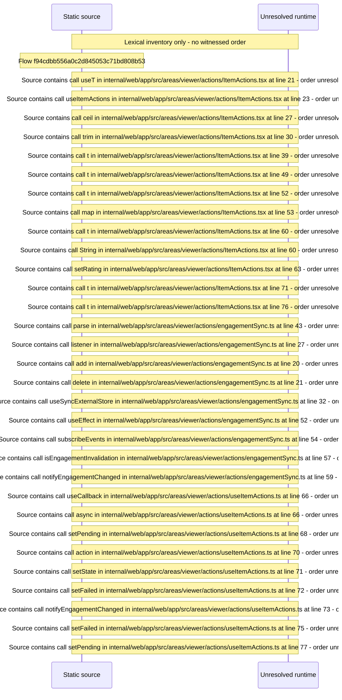

# Viewer item actions: mark watched, watchlist, rating, engagement sync — flow-diagram

Source revision: d442b4a6a38de86be0670669b3a3f6aa47e80b22. Trust: generated. Freshness: pinned source; run docs flows check for a later revision.

<!-- flowdocs:paragraph:94cd4425ea529e3382576b74c56f578e -->
Static source inventory only; sequence and runtime ordering are unresolved\.

Source: internal/web/app/src/areas/viewer/actions/ItemActions\.tsx:14; symbol: ItemActions; span SHA256: 85ab1520079dbcd0e9f1b630a4fe1893bc09c86ff3fc09210cc70e03ae75cf84.

