# Player up\-next countdown and play queue navigation — flow-diagram

Source revision: b952880cf4519beaa9738e25e349aabf600c9a41. Trust: generated. Freshness: pinned source; run docs flows check for a later revision.

<!-- flowdocs:paragraph:b5b269684b9427142beb259b4bb203d8 -->
Static source inventory only; sequence and runtime ordering are unresolved\.

Source: internal/web/app/src/areas/viewer/lib/playQueue\.ts:16; symbol: MAX\_STEPS\_BACK; span SHA256: 817b0ee1a34dbed2e1b5495a55e80bacc4b4be912abf2b780cc1001ca19a2637.

```mermaid
sequenceDiagram
    participant S as Static source
    participant U as Unresolved runtime
    Note over S,U: Lexical inventory only - no witnessed order
    Note over S: Flow fa22fc31bb8d11236cda2f671f818c4a
    Note over S,U: Source contains call getIdentityEpochSignal in internal/web/app/src/areas/viewer/lib/playQueue.ts at line 39 - order unresolved
    Note over S,U: Source contains call activeQueue in internal/web/app/src/areas/viewer/lib/playQueue.ts at line 141 - order unresolved
    Note over S,U: Source contains call fetchLibraryItems in internal/web/app/src/areas/viewer/lib/playQueue.ts at line 102 - order unresolved
    Note over S,U: Source contains call max in internal/web/app/src/areas/viewer/lib/playQueue.ts at line 107 - order unresolved
    Note over S,U: Source contains call Set in internal/web/app/src/areas/viewer/lib/playQueue.ts at line 111 - order unresolved
    Note over S,U: Source contains call filter in internal/web/app/src/areas/viewer/lib/playQueue.ts at line 112 - order unresolved
    Note over S,U: Source contains call playable in internal/web/app/src/areas/viewer/lib/playQueue.ts at line 112 - order unresolved
    Note over S,U: Source contains call has in internal/web/app/src/areas/viewer/lib/playQueue.ts at line 112 - order unresolved
    Note over S,U: Source contains call push in internal/web/app/src/areas/viewer/lib/playQueue.ts at line 114 - order unresolved
    Note over S,U: Source contains call set in internal/web/app/src/areas/viewer/lib/playQueue.ts at line 115 - order unresolved
    Note over S,U: Source contains call activeQueue in internal/web/app/src/areas/viewer/lib/playQueue.ts at line 128 - order unresolved
    Note over S,U: Source contains call activeQueue in internal/web/app/src/areas/viewer/lib/playQueue.ts at line 133 - order unresolved
    Note over S,U: Source contains call get in internal/web/app/src/areas/viewer/lib/playQueue.ts at line 133 - order unresolved
    Note over S,U: Source contains call activeQueue in internal/web/app/src/areas/viewer/lib/playQueue.ts at line 161 - order unresolved
    Note over S,U: Source contains call positionOf in internal/web/app/src/areas/viewer/lib/playQueue.ts at line 163 - order unresolved
    Note over S,U: Source contains call get in internal/web/app/src/areas/viewer/lib/playQueue.ts at line 166 - order unresolved
    Note over S,U: Source contains call finiteNumber in internal/web/app/src/areas/viewer/lib/transport.ts at line 394 - order unresolved
    Note over S,U: Source contains call finiteNumber in internal/web/app/src/areas/viewer/lib/transport.ts at line 398 - order unresolved
    Note over S,U: Source contains call isArray in internal/web/app/src/areas/viewer/lib/watchQueue.ts at line 135 - order unresolved
    Note over S,U: Source contains call filter in internal/web/app/src/areas/viewer/lib/watchQueue.ts at line 137 - order unresolved
    Note over S,U: Source contains call map in internal/web/app/src/areas/viewer/lib/watchQueue.ts at line 144 - order unresolved
    Note over S,U: Source contains call useT in internal/web/app/src/areas/viewer/player/UpNextCard.tsx at line 19 - order unresolved
    Note over S,U: Source contains call t in internal/web/app/src/areas/viewer/player/UpNextCard.tsx at line 21 - order unresolved
    Note over S,U: Source contains call t in internal/web/app/src/areas/viewer/player/UpNextCard.tsx at line 22 - order unresolved
    Note over S,U: Source contains call t in internal/web/app/src/areas/viewer/player/UpNextCard.tsx at line 25 - order unresolved
    Note over S,U: Source contains call max in internal/web/app/src/areas/viewer/player/UpNextCard.tsx at line 26 - order unresolved
    Note over S,U: Source contains call t in internal/web/app/src/areas/viewer/player/UpNextCard.tsx at line 27 - order unresolved
    Note over S,U: Source contains call t in internal/web/app/src/areas/viewer/player/UpNextCard.tsx at line 31 - order unresolved
    Note over S,U: Source contains call t in internal/web/app/src/areas/viewer/player/UpNextCard.tsx at line 34 - order unresolved
    Note over S,U: Source contains call useState in internal/web/app/src/areas/viewer/player/useUpNext.ts at line 34 - order unresolved
    Note over S,U: Source contains call useState in internal/web/app/src/areas/viewer/player/useUpNext.ts at line 35 - order unresolved
    Note over S,U: Source contains call useRef in internal/web/app/src/areas/viewer/player/useUpNext.ts at line 36 - order unresolved
    Note over S,U: Source contains call useRef in internal/web/app/src/areas/viewer/player/useUpNext.ts at line 37 - order unresolved
    Note over S,U: Source contains call useRef in internal/web/app/src/areas/viewer/player/useUpNext.ts at line 39 - order unresolved
    Note over S,U: Source contains call useRef in internal/web/app/src/areas/viewer/player/useUpNext.ts at line 41 - order unresolved
    Note over S,U: Source contains call useRef in internal/web/app/src/areas/viewer/player/useUpNext.ts at line 43 - order unresolved
    Note over S,U: Source contains call getIdentityEpochSignal in internal/web/app/src/areas/viewer/lib/playQueue.ts at line 79 - order unresolved
    Note over S,U: Source contains call useCallback in internal/web/app/src/areas/viewer/player/useUpNext.ts at line 53 - order unresolved
    Note over S,U: Source contains call clearTimer in internal/web/app/src/areas/viewer/player/useUpNext.ts at line 55 - order unresolved
    Note over S,U: Source contains call current in internal/web/app/src/areas/viewer/player/useUpNext.ts at line 57 - order unresolved
    Note over S,U: Source contains call setVisible in internal/web/app/src/areas/viewer/player/useUpNext.ts at line 60 - order unresolved
    Note over S,U: Source contains call clearTimer in internal/web/app/src/areas/viewer/player/useUpNext.ts at line 96 - order unresolved
    Note over S,U: Source contains call setVisible in internal/web/app/src/areas/viewer/player/useUpNext.ts at line 97 - order unresolved
    Note over S,U: Source contains call useCallback in internal/web/app/src/areas/viewer/player/useUpNext.ts at line 46 - order unresolved
    Note over S,U: Source contains call clearInterval in internal/web/app/src/areas/viewer/player/useUpNext.ts at line 48 - order unresolved
    Note over S,U: Source contains call useCallback in internal/web/app/src/areas/viewer/player/useUpNext.ts at line 64 - order unresolved
    Note over S,U: Source contains call clearTimer in internal/web/app/src/areas/viewer/player/useUpNext.ts at line 66 - order unresolved
    Note over S,U: Source contains call setVisible in internal/web/app/src/areas/viewer/player/useUpNext.ts at line 67 - order unresolved
    Note over S,U: Source contains call inWindow in internal/web/app/src/areas/viewer/player/useUpNext.ts at line 102 - order unresolved
    Note over S,U: Source contains call cancel in internal/web/app/src/areas/viewer/player/useUpNext.ts at line 104 - order unresolved
    Note over S,U: Source contains call setCountdown in internal/web/app/src/areas/viewer/player/useUpNext.ts at line 109 - order unresolved
    Note over S,U: Source contains call setVisible in internal/web/app/src/areas/viewer/player/useUpNext.ts at line 110 - order unresolved
    Note over S,U: Source contains call setInterval in internal/web/app/src/areas/viewer/player/useUpNext.ts at line 111 - order unresolved
    Note over S,U: Source contains call inWindow in internal/web/app/src/areas/viewer/player/useUpNext.ts at line 112 - order unresolved
    Note over S,U: Source contains call cancel in internal/web/app/src/areas/viewer/player/useUpNext.ts at line 113 - order unresolved
    Note over S,U: Source contains call setCountdown in internal/web/app/src/areas/viewer/player/useUpNext.ts at line 121 - order unresolved
    Note over S,U: Source contains call advance in internal/web/app/src/areas/viewer/player/useUpNext.ts at line 125 - order unresolved
    Note over S,U: Source contains call maybeShow in internal/web/app/src/areas/viewer/player/useUpNext.ts at line 131 - order unresolved
    Note over S,U: Source contains call maybeShow in internal/web/app/src/areas/viewer/player/useUpNext.ts at line 130 - order unresolved
```

